# Municipal Agents

**AI agents read a city's own documents and turn a proposed municipal decision into a
brief a resident can read in five minutes: what's proposed, how it may affect you, and
when you can have a say.** Every figure links to the page it came from, code checks
that every quote is really on that page, and a named staff member reviews every
statement before it's published.

Built for **CIVIC Hack 2026** (Future Cities Institute, University of
Waterloo, 12 to 14 November 2026) on public data from Waterloo Region, Ontario. It is a
working prototype, not an official city service.

- **Live:** https://municipal-agents.fly.dev (the app: [/decisions](https://municipal-agents.fly.dev/decisions);
  the 2027 budget brief: [/d/row-2027-budget](https://municipal-agents.fly.dev/d/row-2027-budget))
- **Video:** linked from the Devpost submission
- **Docs site:** https://municipal-agents.fly.dev/docs
- **Municipal Readiness Report (one page):** [report/municipal-readiness-report.pdf](report/municipal-readiness-report.pdf)
- **API:** https://municipal-agents.fly.dev/api/openapi.json

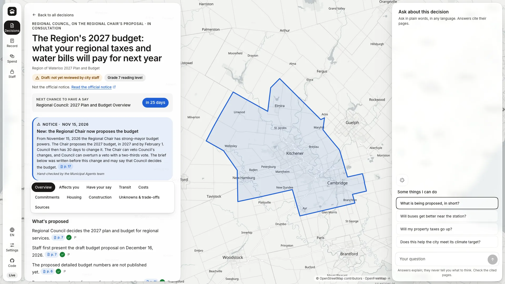

## The problem

The Region of Waterloo's 2027 budget sets regional property taxes and water rates for
everyone in its three cities and four townships. The facts are public, but spread over
a 191-page budget book, asset management reports, transit plans and engagement pages.
Staff present it to Regional Council on 16 December 2026; to speak, residents must
register by noon on 9 December. And from 15 November 2026 the Regional Chair has
strong-mayor budget powers, so the Chair proposes the budget by 1 February 2027 and
Council then has fixed windows to amend, veto and override. Most people affected will
never find those dates.

Staff must explain decisions accurately, to everyone, in many languages, with small
teams. A general chatbot can't help: it can state a wrong figure with confidence, and a
city can't publish what it hasn't checked.

## What it does

| For | What they get |
|---|---|
| **Residents** | A five-minute brief: what's proposed and why now; "how it may affect you" for 11 audiences (renters, transit riders, seniors, people with a disability, newcomers and more); "have your say" with the next date, a countdown, how to take part, a calendar file and feed. Every number opens the PDF page with the quote highlighted. Ask anything in plain words, in 11 languages, and watch the agents work. |
| **Clerks and communications staff** | Agents draft from the documents staff choose; each statement arrives with its quote and page already checked. Approve, edit or reject each one with a note, then publish under your name. See what residents are asking, without seeing anyone's details. |
| **Planners** | Five lenses on the same decision, computed in code: transit access, lifecycle cost, commitments, the housing pipeline and a construction scout. |
| **Councillors and community groups** | A neutral, cited explainer to share, and the dates people can speak. |
| **City IT and web teams** | One process, one container, one settings file per city, an embeddable card for the city's own site, an OpenAPI, no resident data. |

### The five lenses (and the four other challenges)

| Challenge | Lens | How |
|---|---|---|
| 1. Making municipal decisions easier to understand | The brief itself | Plain-language summary, impacts by audience, have your say |
| 2. Finding gaps in transit access | **Transit** | Connection Scan Algorithm over Grand River Transit's bus and ION timetables, 2021 census population and 626 OpenStreetMap destinations: who can reach a hospital, grocery store or school within 45 minutes at 8 am, 10 pm and Sunday morning; service gaps; ranked fixes with trade-offs |
| 3. Making long-term infrastructure costs visible | **Cost** | Capital, operating, maintenance and renewal over the asset's life, per household, built in code from cited budget figures, with sliders for every assumption |
| 4. Tracking a city's commitments | **Commitments** | Each public target the decision touches, its latest cited progress, on track or behind |
| 5. From housing approval to construction | **Housing** | Homes at each stage from approval to completion in Kitchener, Waterloo and Cambridge, median days between stages, and where public data stops |
| (more) | **Construction scout** | An illustrated what-if: ION Stage 2 in twin tunnels under Highway 401 and the Speed River, with candidate work sites scored from open data, cross-passages (NFPA 130) and boreholes (FHWA-NHI-10-034), seven steps and what neighbours would notice. A scenario for discussion, never a Region plan. |

| | |
|---|---|
| 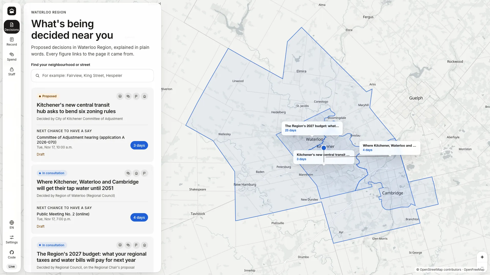 | 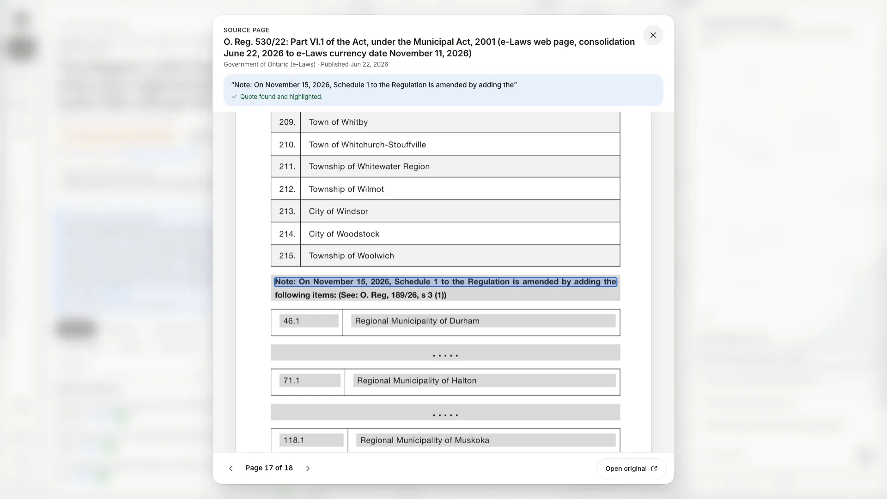 |
| 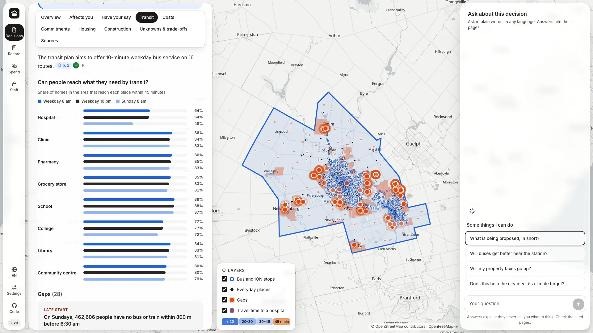 | 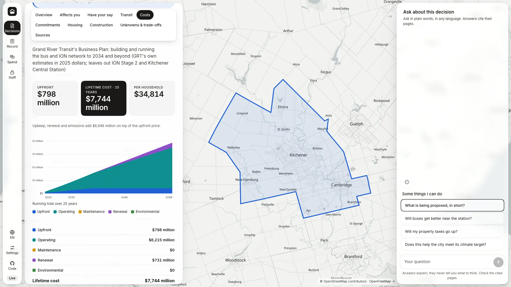 |
| 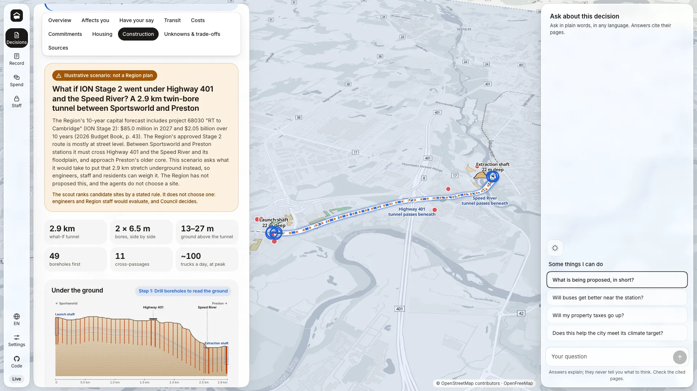 | 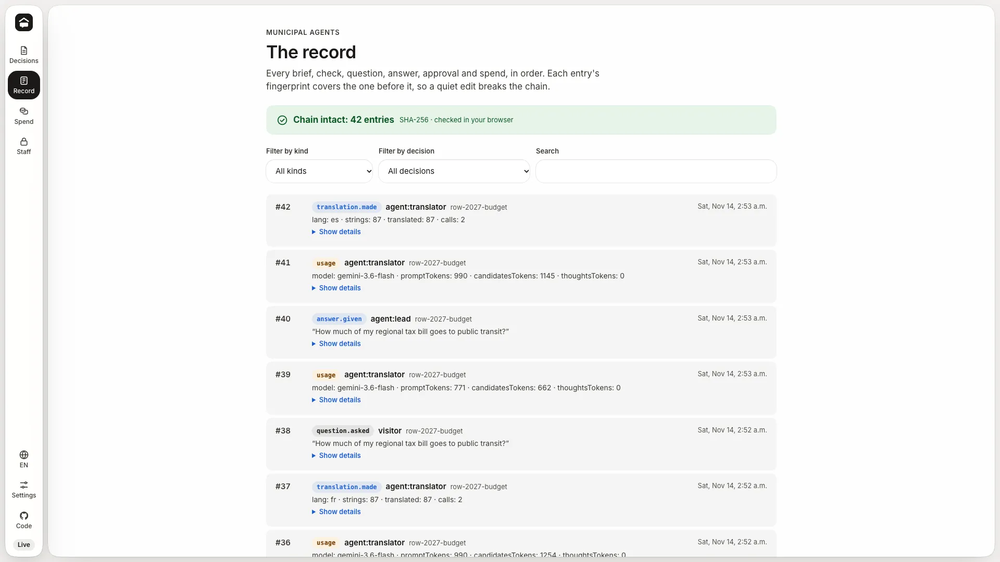 |
| 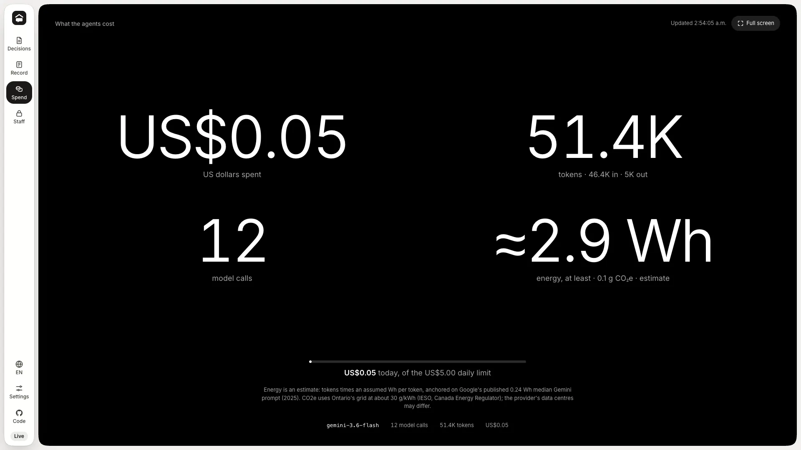 | 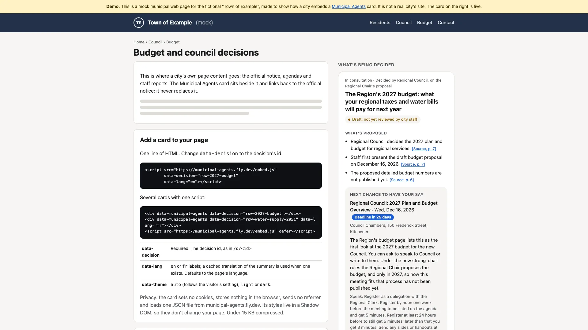 |
| 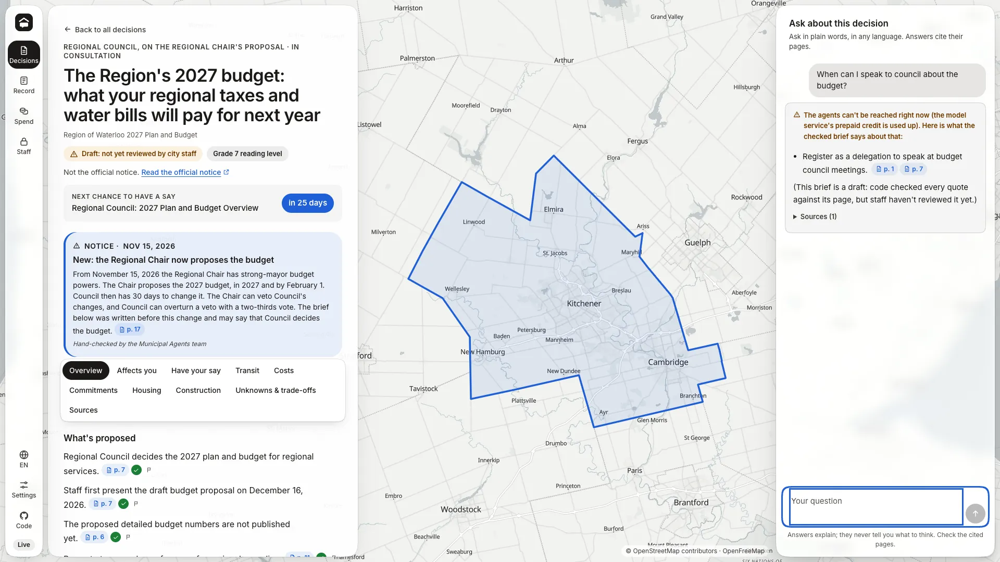 | 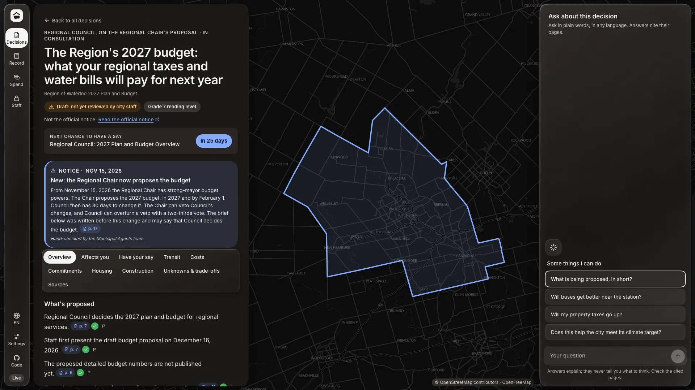 |

More screenshots in [docs/media/](docs/media/): the landing page and the staff screen.

## How it stays honest

These are product rules, enforced in code, not left to the model:

1. **Every figure cites a page.** A statement is accepted only if each quote is found on
   the cited page ([`shared/verify.ts`](shared/verify.ts)). In four brief runs the
   checker rejected 78 attempts and accepted 116, telling the agent each time where the
   quote really was.
2. **Plain words.** Reading grade measured and shown: 7.4, 6.7 and 6.9 for our three
   briefs (target 8).
3. **Agents never decide, and never say what residents should think.** Advocacy wording
   is refused; answer sentences with voting advice or unsupported numbers are dropped.
4. **Staff publish.** Publishing is refused until a named person has reviewed every
   statement; edits are re-checked; rejected statements never reach residents. Before a
   city takes over, the team's own fixes go in a public corrections file, are re-checked
   on their pages and are labelled "Corrected by the Municipal Agents team (not Region
   staff)" (27 across the three demo briefs); the briefs stay drafts.
5. **Weak support is flagged.** Code also checks that each sentence shares words or
   numbers with its quotes; a weak match is labelled for the reader (0 in the three briefs).
6. **The record can't be edited quietly.** Every brief, check, question, answer,
   approval and dollar spent is in a hash-chained log your browser verifies. Content can
   still be purged under a records-retention by-law without breaking the chain.
7. **It keeps working when the AI doesn't.** Repeated questions are replayed from the
   record at no cost; when the model can't be reached, answers come from statements
   already checked. (Our model credit ran out at 2:20 am during the hackathon; the site
   kept answering.)
8. **Not the official notice**, and every page links to the official notice.
9. **Accessible.** axe-core finds 0 violations on the main pages and every decision tab,
   on desktop and phone, light and dark.
10. **Public data only.** No accounts, no tracking; questions are stored without identity.

## How it's built

One **Node 24** process (`node:http`, `node:sqlite`, TypeScript run directly, no
framework, no runtime dependencies on the server) serves the app, the landing site, the
docs and the API. **Agents** are a small loop we can explain: a lead plans and seven
specialists (explainer, transit-access, lifecycle-cost, commitments, housing-pipeline,
construction-scout, translator) follow plain Markdown skill files, calling **Gemini 3.6
Flash** over its REST API to search pages, read pages and record statements. **Lenses**
are computed ahead of time from open data. It runs on **one Fly.io machine in Toronto**
with a volume for the record.

```
browser ── HTTPS ──> one Node 24 process on Fly.io (Toronto) ── HTTPS ──> Gemini API
                     server/ agents/ shared/ lenses/ + SQLite hash-chained log
                     data/: sources (PDF + page text), decisions, briefs, lenses, runs
ahead of time: PDFs to page text; GTFS, OpenStreetMap, census, permits -> lens files
```

| | Measured (14 November 2026) |
|---|---|
| One full brief, five lenses | US$0.24–0.37 in model fees, about 40 calls |
| One question | about US$0.05–0.07 (eval averages); a repeated question US$0 |
| One translation of a brief | about US$0.009 per language |
| Hosting | about US$7–10 a month |
| A year for one city (50 briefs, 5,000 questions) | about US$360–500 at 2026 model prices; about US$630–870 from 2027 |
| Tests | all passing (`npm test`) |
| Accessibility | 0 axe-core violations (main pages and every decision tab, 1280 and 390 px, light and dark) |
| Evals | 6 of 12 questions passed in the latest run; all 6 failures read above grade 9 (one also found nothing to cite); 0 citation failures; 0 voting advice |

Why it's built this way, and how it scales to more decisions and cities:
[docs/architecture.md](docs/architecture.md).

## Run it

Needs Node 24 and Poppler (`pdftotext`, for PDF uploads and `npm run sources`).

```bash
git clone https://github.com/RichardLi-1/municipal-agents.git
cd municipal-agents
npm install                        # development tools only
printf 'GEMINI_API_KEY=your-key\nSTAFF_TOKEN=a-long-random-passcode\n' > .env
npm run build                      # builds the web app into web/dist
npm start                          # http://localhost:4100
npm test                           # all tests, no model calls
```

Without a `GEMINI_API_KEY` everything still works except fresh agent runs: briefs,
lenses, sources and the record are files, and questions are answered from replays and
the checked brief. Settings: [docs/guide/self-host.md](docs/guide/self-host.md#environment-variables).

## Deploy

```bash
fly apps create your-city-agents
fly volumes create municipal_data --region yyz --size 1
fly secrets set GEMINI_API_KEY=your-key STAFF_TOKEN=a-long-random-passcode
fly deploy --remote-only
SMOKE_URL=https://your-city-agents.fly.dev npm run smoke
```

The same `Dockerfile` runs on any container host or the city's own server. Details,
backups and how to use a Canadian-hosted or on-premises model:
[docs/guide/self-host.md](docs/guide/self-host.md).

## Adapt it to your city

Everything a city changes is a plain file; no code changes:

1. **City settings:** `cities/<id>.json` (name, councils, map view, languages, official
   notice page, clerk contact, open data portals). One deployment can serve several.
2. **Documents:** the PDFs residents should be able to check, in `data/sources/`;
   `npm run sources` turns them into page text.
3. **Decisions:** one hand-checked `data/decisions/<id>.json` per decision (title, who
   decides, timeline, ways to take part, area), with notes on what was checked.
4. **Open data:** your GTFS feed for the transit lens; building permits for the housing
   lens; cited budget figures for the cost lens.
5. **Run the agents** from the staff screen, review every statement, publish.

Our estimate: about two days for the brief with the cost and commitments lenses, then
transit and housing as your open data allows. Step by step:
[docs/guide/adapt-your-city.md](docs/guide/adapt-your-city.md).

## Documentation

| Document | What's in it |
|---|---|
| [Municipal Readiness Report](report/municipal-readiness-report.pdf) | One page: who uses it, data and resources, cost, privacy, what residents should know, how other cities adapt it, the case study |
| [Requirements](docs/requirements.md) | Stakeholders, scope, user stories, 45 functional and 15 non-functional requirements, harms and mitigations, traceability to code |
| [Design and UML](docs/design.md) | Eleven diagrams: use cases, components, platform, classes, four sequences, two state machines, deployment ([sources](docs/uml/)) |
| [Architecture](docs/architecture.md) | Decisions and why, alternatives rejected, scalability, failure modes, security and privacy, cost model |
| [Code tour](docs/code-tour.md) | Each folder, the path of a question from browser to Gemini and back, where citations and hashes are checked, how lenses are computed, how AI was used and checked, known weak spots |
| [Planner workflows](docs/planner-workflows.md) | Eight municipal scenarios under Ontario law, mapped to what the product does today |
| [Guides](docs/guide/index.md) | Residents, staff, planners, API, embed, self-hosting, adapting to your city, evals, FAQ |
| [References](docs/references.md) and [CREDITS](CREDITS.md) | Every library, dataset, licence, algorithm, standard and law we used or cite |
| [Devpost text](docs/devpost.md) | The submission |
| [Spec](docs/spec.md) | The product spec we built from |

## AI use

Code, data pipelines and documents were drafted with Claude Code (Anthropic, model
Claude Opus 5.5) directed and reviewed by the team; the product's runtime agents use
Google's Gemini API (gemini-3.6-flash). The construction illustrations were generated
once with Gemini's image model and are labelled as illustrations. How we checked the AI's
work, and what we know is still weak:
[docs/code-tour.md](docs/code-tour.md#how-ai-was-used-and-how-we-checked-it).

## Credits and licence

Built on Node.js, Preact, MapLibre GL JS, PDF.js, OpenFreeMap, OpenStreetMap, Grand River
Transit's GTFS, Region of Waterloo, City of Kitchener, Waterloo and Cambridge open data,
Statistics Canada and Natural Resources Canada data, and the Region's own public
documents. Full list with licences: [CREDITS.md](CREDITS.md).

Code: [MIT](LICENSE). Source documents and datasets keep their publishers' terms (see
[docs/references.md](docs/references.md#3-data)).
