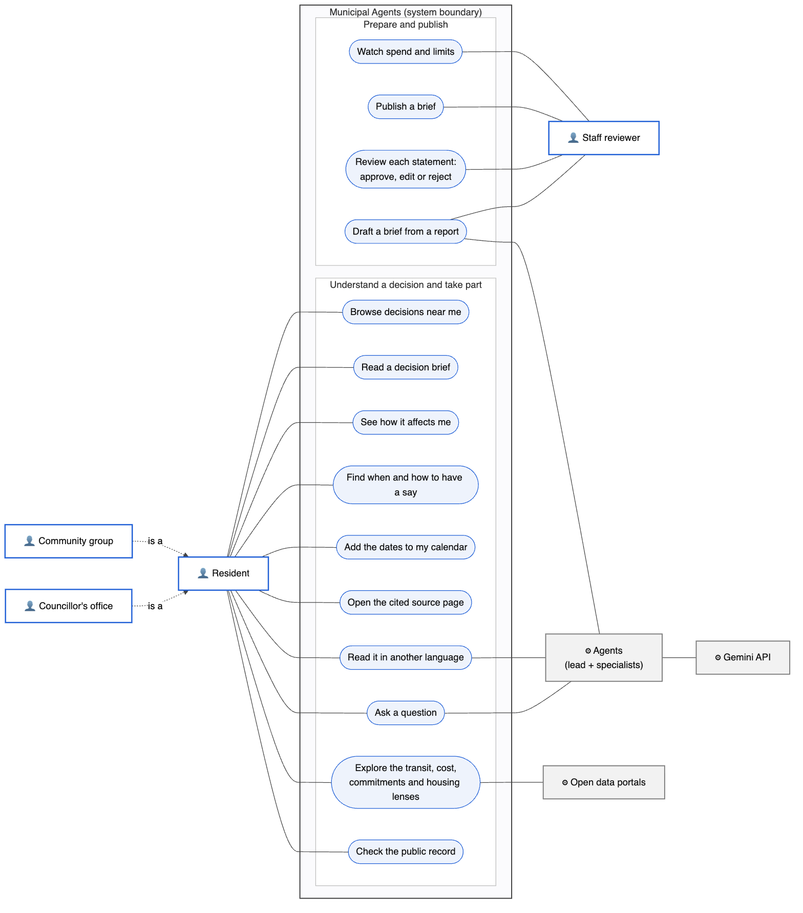
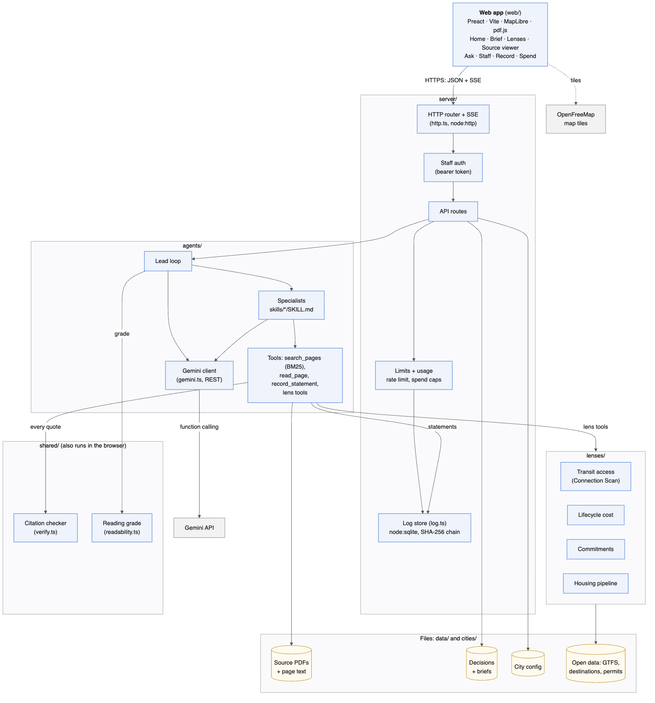
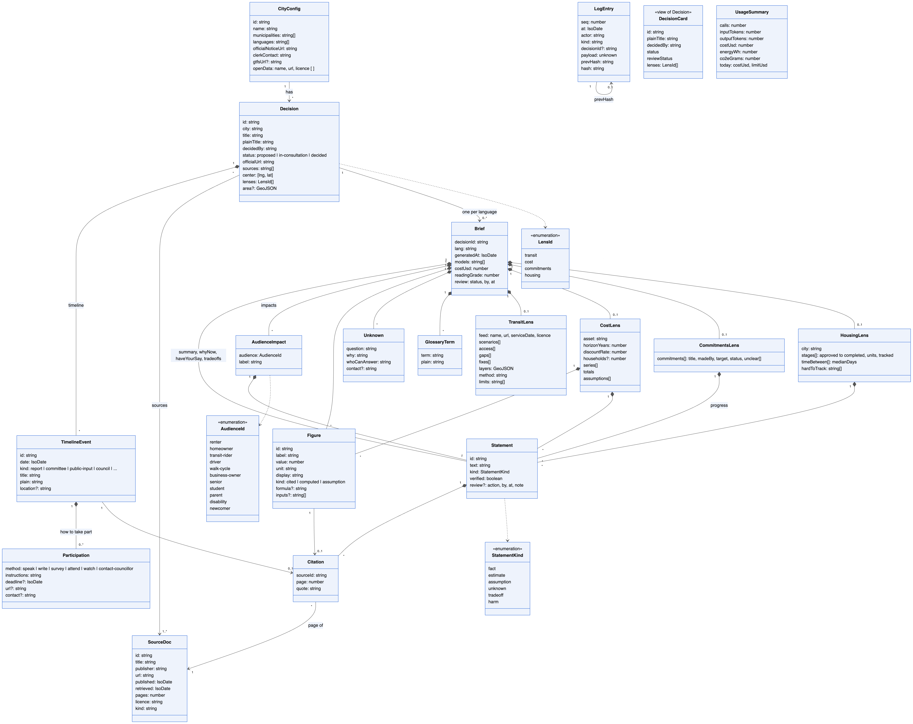
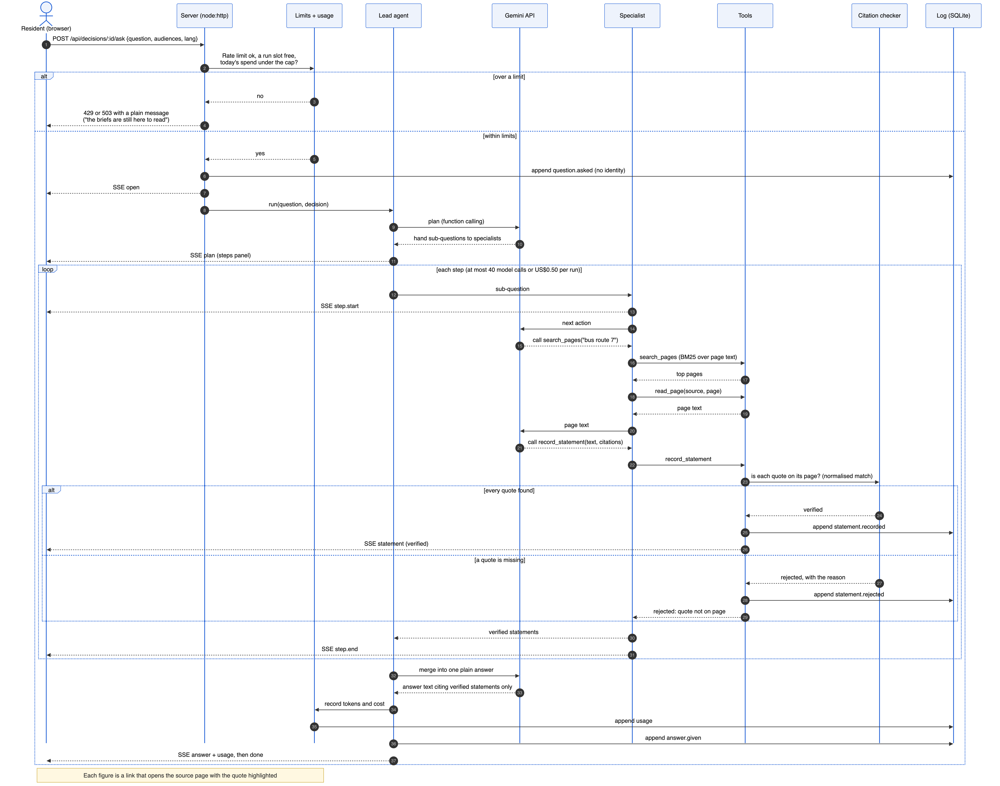
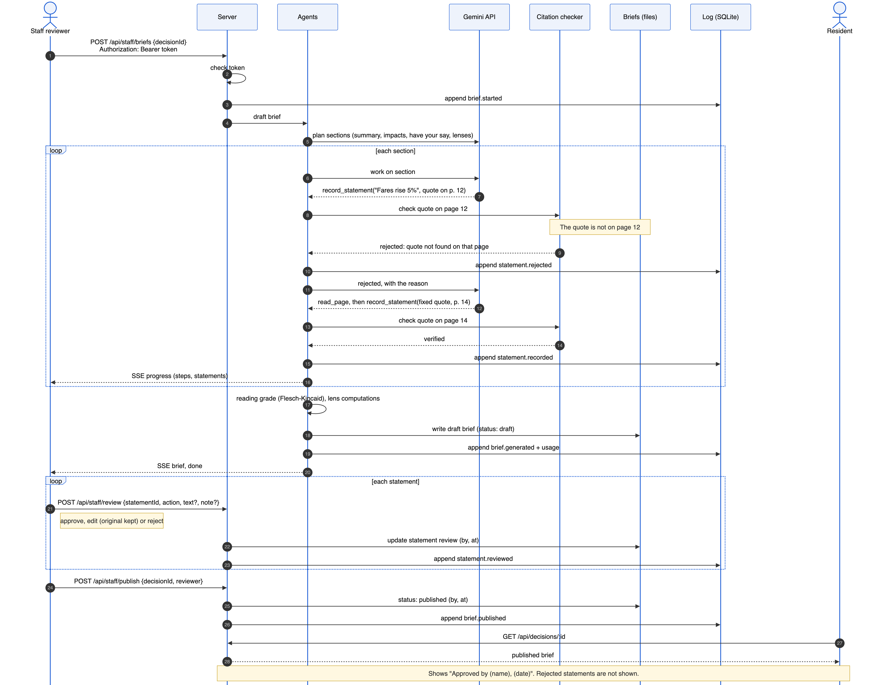
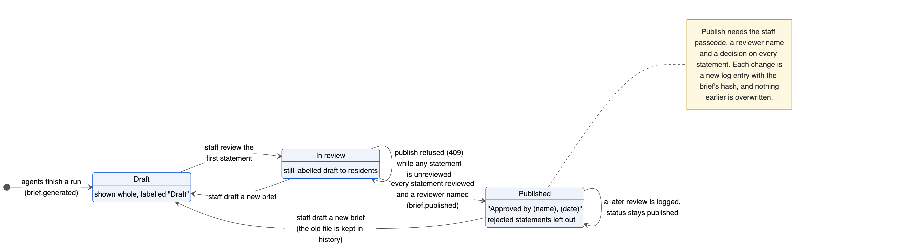
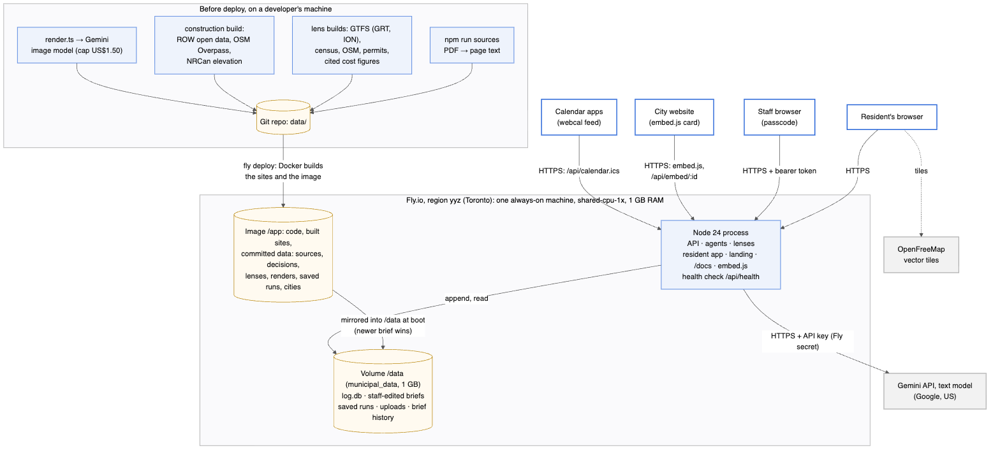

# Design: Municipal Agents in eight diagrams

This page shows how Municipal Agents is put together, in UML. Each diagram has its
Mermaid source (`.mmd`), a vector image (`.svg`) and a picture (`.png`) in
[`docs/uml/`](uml/). To redraw them after a change, run `docs/uml/render.sh` (it uses
`@mermaid-js/mermaid-cli` 11 with the Chrome already on the machine).

Five design rules shape every diagram below. They come from the product spec
([spec.md](spec.md)) and are enforced in code, not left to the model's judgement:

1. **Every figure cites a page.** A statement is kept only if each quote it cites is
   found on the page it names. A program does that check, not the AI.
2. **Checks in code.** Citation matching, the reading grade, the cost arithmetic, the
   transit travel times and the dates are computed by ordinary code that the team can
   test and explain.
3. **Staff publish.** Whatever the agents write is a draft until a named staff member
   approves it.
4. **An append-only record.** Every brief, check, question, answer, approval and dollar
   spent is written to a log where each entry's hash covers the one before, so a quiet
   edit breaks the chain and anyone can see it.
5. **Plain words.** Briefs aim for grade 8 or lower, measured and shown.

---

## 1. Use cases: who does what

[SVG](uml/use-case.svg) · [Mermaid source](uml/use-case.mmd)

Residents are the main actors. They browse decisions near them, read a brief, pick who
they are to see how it may affect them, find the next chance to have a say, add the
dates to a calendar, open any cited page, ask questions, read in another language,
explore the four lenses (transit, cost, commitments, housing) and check the public
record. Councillors' offices and community groups do everything a resident does (the
"is a" arrows), so they need no special accounts or features: a councillor's assistant
answering a constituent uses the same brief and the same citations. Staff reviewers
are the only actors who can change what the public sees: they start a draft, approve,
edit or reject each statement and publish. The agents and the Gemini API sit outside
the system boundary on purpose. They are suppliers of draft text that the system
checks, not decision-makers inside it.

## 2. Components: the parts and how they depend on each other

[SVG](uml/component.svg) · [Mermaid source](uml/component.mmd)

The whole service is one Node 24 process with four code folders. `server/` takes HTTP
requests, checks the staff token, applies rate limits and the daily spend cap, and owns
the log. `agents/` holds the lead loop, the specialists (each described in a plain
`SKILL.md` file a non-programmer can read) and the tools they may call, plus a small
REST client for Gemini with no SDK in between. `shared/` holds the checks that must
never depend on a model: the citation checker (`shared/verify.ts`) and the
Flesch-Kincaid reading grade (`shared/readability.ts`). Because `shared/` has no Node
dependencies, the browser can run the same code. The canonical JSON used for the log's
hashes (`server/canonical.ts`) has a twin in the web app (`web/src/lib/hash.ts`), so
the Record page recomputes the whole chain in the browser with the Web Crypto API and
does not have to take the server's word for it. The two copies must stay identical.
`lenses/` computes the transit, cost, commitments and housing results from open data.
All content lives in plain files under `data/` and `cities/`, so a city can read,
review and version everything the agents read. The design choice: few moving parts
that a municipal IT team can run and audit, and a hard line between what a model
drafts and what code verifies. In `agents/`, `lead.ts` plans and merges, `loop.ts` is
the specialist loop, `tools.ts` holds the tools and their checks, `corpus.ts` the page
search and `gemini.ts` the client. Lenses are precomputed by scripts before deployment
and stored in `data/lenses/`; the agents' lens tools only read them
(`TODO(verify)`: transit and cost lens file names).

## 3. Domain classes: the data every part shares

[SVG](uml/class.svg) · [Mermaid source](uml/class.mmd)

This diagram is drawn from [`shared/types.ts`](../shared/types.ts), the one file that
the data files, the API and the web app all agree on. A `CityConfig` has many
`Decision`s. Each decision has a timeline of events (committee, public input, council)
with the ways to take part, and one `Brief` per language. A brief is made of
`Statement`s (summary, why now, impacts for each audience, trade-offs), `Figure`s,
`Unknown`s, a glossary and up to four lenses. The key relationship is
`Statement → Citation → SourceDoc`: every sentence a resident reads points to a quote
on a numbered page of a named document. A statement's `verified` flag is set only by
the checker, and its `review` records which staff member approved, edited or rejected
it and when (an edit keeps the original text). `Figure.kind` separates numbers quoted
from a document (`cited`), numbers the code worked out (`computed`, with the formula
and inputs) and numbers that are assumptions a resident can change. `LogEntry` links
to the entry before it through `prevHash`, which is what makes the record tamper-evident.
`DecisionCard` and `UsageSummary` are read-only views for the home page and the spend
page.

## 4. Sequence: a resident asks a question

[SVG](uml/seq-ask.svg) · [Mermaid source](uml/seq-ask.mmd)

Before any money is spent, the server checks three limits: a per-visitor rate limit
(the visitor's IP address is held in memory only for that window and is never logged),
a cap on how many agent runs can happen at once, and the day's spend so far against the
daily cap (US$5 on the public site). If a limit is hit, the resident gets a plain
message and the briefs stay readable. Otherwise the question is logged with no
identity attached, and the lead agent asks Gemini to plan. Each specialist searches
the source pages (BM25 keyword ranking), reads the pages it needs and proposes
statements through `record_statement`. The citation checker then looks for each quote
on its page, after normalising case, spacing, curly quotes, dashes, ligatures and
words split across lines, and tolerating the side-by-side columns that PDF text
extraction produces; words must still appear in full and in order. A statement whose
quote is missing is rejected, logged and sent back to the specialist with the reason.
Each run stops at 40 model calls or US$0.50. The resident watches each step arrive
over server-sent events, like a progress panel, and the final answer may only cite
statements that passed the check. Every model call writes its own `usage` entry as
it returns (`budgetedCall` in `agents/loop.ts`); the server writes `answer.given` (and
a fallback `usage` entry) only if the agents have not, so each fact is recorded once.
A rejection returns the reasons in words the model can act on, for example "That quote
is on page 14 of row-2026-budget-book, not page 12. Cite page 14." (`checkCitation` in
`agents/tools.ts`).

## 5. Sequence: staff draft, review and publish a brief

[SVG](uml/seq-brief.svg) · [Mermaid source](uml/seq-brief.mmd)

A staff member starts a brief for a decision using the staff token. The agents work
through each section. The diagram shows the case the system is built for: the model
proposes "Fares rise 5%" with a quote it says is on page 12, the checker does not find
it there, and the statement is rejected and logged rather than shown. The model is told
why, reads the page again, finds the real quote on page 14, and only then is the
statement recorded. When the draft is done, the code computes its reading grade and the
lens results and saves it as a draft. A staff member then reviews each statement:
approve it, edit the wording (the original text is kept with the statement), or reject
it with a note. Publishing needs a reviewer's name, and every review and the publish
itself are new log entries. Residents then see "Approved by (name), (date)", and
rejected statements are not shown. This keeps accountability with a named person at
the city, which is where it belongs. Staff can start a brief either from a decision's
existing sources or by uploading a PDF in the same call (`server/upload.ts`).
`TODO(verify)`: how a staff edit, and a rejected statement, appear on the public page.

## 6. State: the life of a brief

[SVG](uml/state-brief.svg) · [Mermaid source](uml/state-brief.mmd)

A brief has three states, stored in `Brief.review.status`. It starts as a **draft**
when the agents finish, moves to **in review** when staff begin reviewing statements,
and becomes **published** only when a named reviewer publishes it. Until then the
public page labels it "Draft: not yet reviewed by staff". If the staff report changes,
staff can regenerate the brief, which sends it back to draft. Nothing is overwritten
in the record: each step is a new log entry, so the history of who approved what, and
when, survives every regeneration. A brief moves from draft to in review when staff
review its first statement (`POST /api/staff/review`); there is no separate "start
review" action. Publishing does not require every statement to be reviewed: the
`brief.published` entry records how many were approved, edited, rejected and left
unreviewed, so the record shows it.

## 7. State: the life of one statement

[SVG](uml/state-statement.svg) · [Mermaid source](uml/state-statement.mmd)

Each statement passes two independent gates. The first is code: when an agent records
it, the checker either **verifies** it (every quote found on its page) or **rejects**
it, and a rejected statement is never shown as a fact. The second is a person: a staff
reviewer **approves**, **edits** (the original wording is kept) or **rejects** each
verified statement. Splitting the gates this way means a model can never vouch for
itself, and a reviewer spends their time on judgement (is this fair, is it clear, is
anything missing) rather than on hunting for page numbers. If an unverified statement
is shown at all, it carries an "unverified" label. In practice the agents' tools
store only statements that passed the check, so every statement in a brief is verified;
the failed attempts live only in the record as `statement.rejected` entries with their
reasons.

## 8. Deployment: where it runs

[SVG](uml/deployment.svg) · [Mermaid source](uml/deployment.mmd)

Data is prepared at build time on a developer's machine: source PDFs are turned into
page text with `pdftotext`, and the transit schedules (Grand River Transit and ION
GTFS), essential destinations from OpenStreetMap, and permit and development data are
fetched and saved under `data/`. `fly deploy` builds one Docker image that carries
the code, the built web app and those files. It runs as one machine on Fly.io in the
`yyz` (Toronto) region, with a 1 GB volume at `/data` that holds only the SQLite log,
so the record survives redeploys. Residents' and staff browsers talk to it over HTTPS;
map tiles come straight from OpenFreeMap. The only call that leaves Canada is to the
Gemini API (a Google service, processed in the US), with the API key held as a Fly
secret. That is the main data-residency limit of the prototype: a production
deployment for a city should use a Canadian-hosted or on-premises model, which the
design allows because the model is called through one small client file
(`agents/gemini.ts`). See [architecture.md](architecture.md) for the reasoning and
scaling path. Per `fly.toml`: one `shared-cpu-1x` machine with 1 GB of memory,
always on, health-checked on `/api/health`, and a 1 GB volume `municipal_data` at
`/data`. The image carries the committed data (sources, decisions, lenses, committed
briefs); at start-up `server/data.ts` mirrors it into the volume, where the record,
staff-edited briefs and uploads are written.
