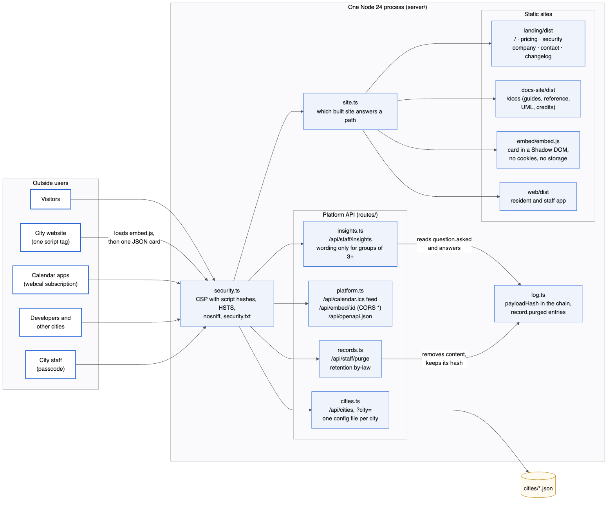
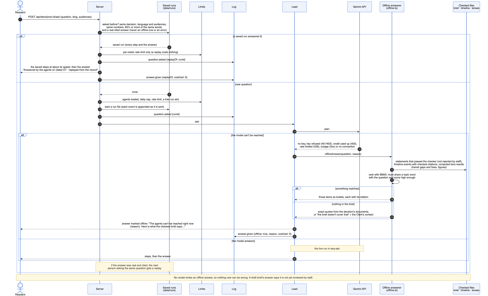
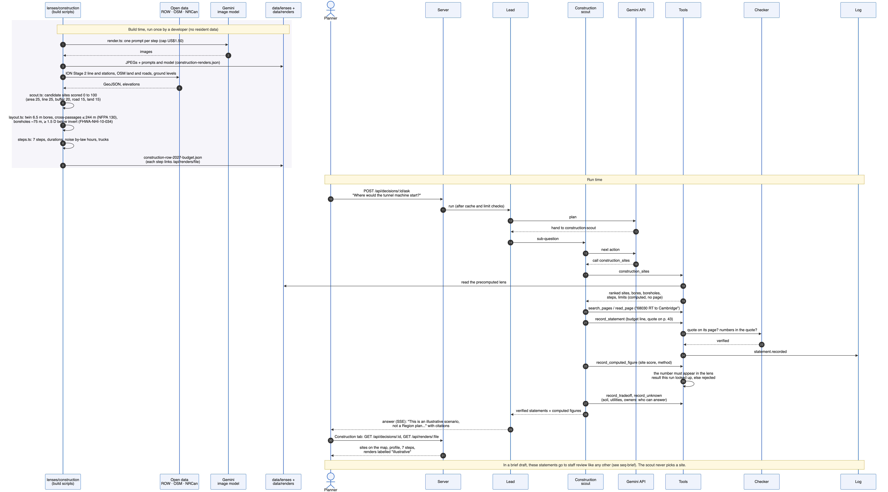
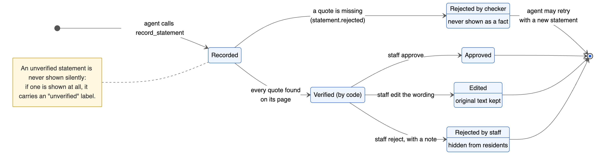

# Design: Municipal Agents in eleven diagrams

This page shows how Municipal Agents is put together, in UML. Each diagram has its
Mermaid source (`.mmd`), a vector image (`.svg`) and a picture (`.png`) in
[`docs/uml/`](uml/). To redraw them after a change, run `docs/uml/render.sh` (it uses
`@mermaid-js/mermaid-cli` 11 with the Chrome already on the machine; pass one file
name to redraw just that diagram). Every diagram was checked against the code named
under it.

Five design rules shape every diagram below. They come from the product spec
([spec.md](spec.md)) and are enforced in code, not left to the model's judgement:

1. **Every figure cites a page.** A statement is kept only if each quote it cites is
   found on the page it names. A program does that check, not the AI.
2. **Checks in code.** Citation matching, the reading grade, the cost arithmetic, the
   transit travel times, the construction layout rules and the dates are computed by
   ordinary code that the team can test and explain.
3. **Staff publish.** Whatever the agents write is a draft until a named staff member
   has reviewed every statement and published it.
4. **An append-only record.** Every brief, check, question, answer, review and dollar
   spent is written to a log where each entry's hash covers the one before, so a quiet
   edit breaks the chain and anyone can see it.
5. **Plain words.** Briefs aim for grade 8 or lower, measured and shown.

| # | Diagram | Shows |
|---|---|---|
| 1 | [Use cases](#1-use-cases-who-does-what) | Who uses the system and for what |
| 2 | [Components: core](#2-components-the-core) | The parts that turn documents into checked briefs and answers |
| 3 | [Components: platform](#3-components-the-platform-around-it) | Landing site, docs, embed widget, feeds, insights, records retention |
| 4 | [Domain classes](#4-domain-classes-the-data-every-part-shares) | The shared data shapes |
| 5 | [A resident asks](#5-sequence-a-resident-asks-a-question) | A live agent run, step by step |
| 6 | [Cache and offline](#6-sequence-answers-without-a-new-model-run) | Replays at US$0, and answers when the model is down |
| 7 | [Staff draft and publish](#7-sequence-staff-draft-review-and-publish-a-brief) | Drafting, the citation check rejecting a quote, review, publish |
| 8 | [Construction scout](#8-sequence-the-construction-scout) | A computed what-if scenario, explained with citations |
| 9 | [Brief states](#9-state-the-life-of-a-brief) | Draft, in review, published |
| 10 | [Statement states](#10-state-the-life-of-one-statement) | Checked by code, then by a person |
| 11 | [Deployment](#11-deployment-where-it-runs) | Where everything runs |

---

## 1. Use cases: who does what

[SVG](uml/use-case.svg) · [Mermaid source](uml/use-case.mmd)

Residents are the main actors. They browse decisions near them, read a brief, pick who
they are to see how it may affect them, find the next chance to have a say, add the
dates to a calendar or subscribe to a feed, open any cited page, ask questions, read in
another language, explore the five lenses (transit, cost, commitments, housing,
construction) and check the public record. Councillors' offices and community groups
do everything a resident does (the "is a" arrows), so they need no special accounts or
features: a councillor's assistant answering a constituent uses the same brief and the
same citations. A city's own website is an actor too: it shows a decision card with one
script tag. Staff reviewers are the only people who can change what the public sees:
they start a draft, approve, edit or reject each statement and publish. They can also
see what residents are asking (only in groups of three or more similar questions),
purge a record's content when the city's retention by-law requires it, and watch the
spend. The agents and the Gemini API sit outside the system boundary on purpose. They
supply draft text that the system checks; they decide nothing.

## 2. Components: the core

[SVG](uml/component.svg) · [Mermaid source](uml/component.mmd)

The whole service is one Node 24 process. `server/` takes HTTP requests
(`http.ts`, on `node:http`), checks the staff passcode, applies a per-visitor rate
limit, a cap on runs at once and the daily spend cap (`limits.ts`, `usage.ts`), and owns
the log (`log.ts`, on `node:sqlite`). `runfiles.ts` saves every agent run's events to
`data/runs/`; those files are both the evidence of what the agents said and the answer
cache. `statements.ts` holds the review rules: every statement needs a staff decision
before publishing, an edit is re-checked against its pages, and the published brief
leaves out what staff rejected. In `agents/`, `lead.ts` plans, runs the specialists in
parallel and merges their verified statements; `loop.ts` is the specialist loop with
its budget; each of the seven specialists (explainer, transit-access, lifecycle-cost,
commitments, housing-pipeline, construction-scout, translator) is described in a plain
`skills/<name>/SKILL.md` file a non-programmer can read; `tools.ts` holds the tools and their checks; `offline.ts`
answers from already-checked material when the model can't be reached; `gemini.ts` is a
small REST client with no SDK in between. `shared/` holds the checks that must never
depend on a model: the citation checker (`verify.ts`) and the Flesch-Kincaid reading
grade (`readability.ts`). The canonical JSON used for the log's hashes
(`server/canonical.ts`) has a twin in the web app (`web/src/lib/hash.ts`), so the Record
page recomputes the whole chain in the browser with the Web Crypto API and does not
have to take the server's word for it; the two copies must stay identical. `lenses/`
has one folder per lens: `transit` (Connection Scan over the GRT and ION schedules),
`cost` (lifecycle cost built in code from cited figures), `commitments` (status
computed from baseline, target and latest figure), `housing` (approval-to-completion
pipeline) and `construction` (site scouting, tunnel layout and steps). Their build
scripts run before deployment and write results to `data/lenses/`; at run time the
agents' lens tools read those results and call small summary and maths functions. All
content lives in plain files under `data/` and `cities/`, so a city can read, review and
version everything the agents read. The design choice: few moving parts that a
municipal IT team can run and audit, and a hard line between what a model drafts and
what code verifies.

## 3. Components: the platform around it

[SVG](uml/component-platform.svg) · [Mermaid source](uml/component-platform.mmd)

The same process also serves everything a city needs around the briefs, so there is
still only one thing to deploy. `site.ts` decides which built site answers a path: the
marketing site (`landing/dist`) at `/`, the documentation (`docs-site/dist`) at `/docs`,
the embeddable widget (`embed/embed.js`), and the resident and staff app (`web/dist`)
for everything else. A city website adds one script tag; the widget draws a compact
card in a Shadow DOM, sets no cookies, stores nothing and fetches one JSON file
(`/api/embed/:id`, readable from any origin). `routes/cities.ts` serves several
municipalities from one deployment: each city is one `cities/<id>.json` file, and
adding a second city needs no code change. `routes/platform.ts` publishes a calendar
feed of many decisions (`/api/calendar.ics`, subscribable as webcal) and an OpenAPI 3.1
description of the whole API. `routes/insights.ts` tells staff what residents are
asking without exposing anyone: counts only, and question wording appears only for a
group of at least three similar questions (k-anonymity with k = 3), with emails, phone
numbers, web addresses, postal codes and long numbers removed. `routes/records.ts` lets
staff purge one entry's content when its retention period under the city's records
retention by-law has ended (Municipal Act, 2001, s. 255): the chain hashes each
payload's own SHA-256 rather than the payload, so the content can go while the entry's
header, its payload hash and a new `record.purged` entry (who, why) keep the chain
verifiable. `security.ts` sets the security headers on every response: a
Content-Security-Policy that allows only this origin's scripts plus the SHA-256 hashes
of each page's inline scripts, HSTS, `nosniff`, a strict referrer policy, a permissions
policy, and a `security.txt`.

## 4. Domain classes: the data every part shares

[SVG](uml/class.svg) · [Mermaid source](uml/class.mmd)

This diagram is drawn from [`shared/types.ts`](../shared/types.ts), the one file that
the data files, the API and the web app all agree on. A `CityConfig` has many
`Decision`s. Each decision has a timeline of events (committee, public input, council)
with the ways to take part, and one `Brief` per language. A brief is made of
`Statement`s (summary, why now, impacts for each audience, trade-offs), `Figure`s,
`Unknown`s, a glossary and up to five lenses. The key relationship is
`Statement → Citation → SourceDoc`: every sentence a resident reads points to a quote
on a numbered page of a named document. A statement's `verified` flag is set only by
the checker, and its `review` records which staff member approved, edited or rejected
it and when (an edit keeps the original text). `Figure.kind` separates numbers quoted
from a document (`cited`), numbers the code worked out (`computed`, with the method)
and assumptions a resident can change with a slider. The `ConstructionLens` holds a
scenario that is labelled as illustrative: ranked `ConstructionSite`s with a 0 to 100
score and the reasons and concerns behind it, the bores, cross-passages and boreholes,
and seven `ConstructionStep`s, each with what residents would notice and an optional
illustration marked `illustrative`. `LogEntry` links to the entry before it through
`prevHash`; its `hash` covers the `payloadHash`, which is what lets a payload be purged
under a retention by-law without breaking the chain. `DecisionCard` and
`UsageSummary` are read-only views for the home page and the spend page.

## 5. Sequence: a resident asks a question

[SVG](uml/seq-ask.svg) · [Mermaid source](uml/seq-ask.mmd)

This is the live path, when the question is new and the model is reachable (diagram 6
covers the other two). Before any money is spent, the server checks that the agents are
loaded, that today's spend is under the daily cap (US$5 on the public site), the
per-visitor rate limit (the IP address is held in memory only for that window and never
logged) and that a run slot is free. If a limit is hit, the resident gets a plain
message and the briefs stay readable. Otherwise the question is logged with no identity
attached, and the lead agent asks Gemini to plan. Each specialist searches the source
pages (BM25 keyword ranking), reads the pages it needs and proposes statements through
`record_statement`. The checker then looks for each quote on its page, after
normalising case, spacing, curly quotes, dashes, ligatures and words split across lines,
and tolerating the side-by-side columns that PDF text extraction produces; words must
still appear in full and in order. It also requires every number in the sentence to
appear in a quote. A statement that fails is rejected, logged with its reasons and sent
back to the specialist, in words it can act on ("That quote is on page 14 of
row-2026-budget-book, not page 12. Cite page 14."). Each run stops at 40 model calls or
US$0.50, and every model call writes its own `usage` entry as it returns. The lead then
writes the answer from the numbered verified statements; code keeps only the citation
markers that point to real statements and drops any sentence that states a number no
statement backs, and a plain-language pass aims for grade 8. The resident watches each
step arrive over server-sent events.

## 6. Sequence: answers without a new model run

[SVG](uml/seq-offline.svg) · [Mermaid source](uml/seq-offline.mmd)

Two paths keep the service useful and cheap. First, the **answer cache**: every live
run's events are saved to `data/runs/<runId>.jsonl`. When a new question matches one a
real run already answered (same decision, language and audiences, the same numbers, and
85% or more of the same words, or identical after normalising), the server replays that
run's steps at about four times their real speed and labels the answer "Answered by
the agents on (date) ET · replayed from the record". A replay costs nothing, so it
skips the daily cap (the per-visitor limit still applies) and is logged with
`costUsd: 0` and the run it replays. Only real, cited answers are ever replayed: never
an offline answer, an error or a "couldn't find". Second, the **offline answerer**:
when Gemini can't be reached (no key, key refused, prepaid credit used up, rate
limited, an outage or no connection), the lead hands the question to
`agents/offline.ts`. It ranks, with BM25, only material that has already been checked:
the brief's verified statements that staff didn't reject, the decision's timeline
events with checked citations, and computed lens results such as transit gaps and
fixes. An item must share a real topic word with the question and score well enough. If
nothing in the brief matches, it falls back to exact quotes from the decision's
documents, and if those don't match either, it says so and gives the Clerk's contact.
The answer is marked offline and says why. No model writes it, so nothing new can be
wrong.

## 7. Sequence: staff draft, review and publish a brief

[SVG](uml/seq-brief.svg) · [Mermaid source](uml/seq-brief.mmd)

A staff member starts a brief for a decision, either from its existing sources or by
uploading a PDF in the same call (`server/upload.ts`), using the staff passcode (checked
in constant time). The agents work through each section. The diagram shows the case the
system is built for: the model proposes "Fares rise 5%" with a quote it says is on
page 12, the checker finds that quote on page 14 instead, and the statement is rejected
and logged rather than shown. The model is told exactly why, cites page 14, and only
then is the statement recorded. When the draft is done, it gets a reading grade, its
lens figures and a plain-language pass, and is saved as a draft (the previous file is
copied to a history folder first). A staff member then reviews every statement:
approve it, edit the wording, or reject it with a note. An edit is re-checked against
its pages straight away, so `verified` always says what the checker says, and the
original wording is kept. Publishing needs a reviewer's name and a decision on every
statement; until then the server refuses with a 409 that says how many are left. Every
review and the publish itself are new log entries carrying the brief's hash. Residents
then see "Approved by (name), (date)", an "Edited by staff" badge next to edited
statements, and no rejected statements. Staff can also replay the agents' last real
drafting run for a demonstration, with no model call and no spend. This keeps
accountability with a named person at the city, which is where it belongs.

## 8. Sequence: the construction scout

[SVG](uml/seq-scout.svg) · [Mermaid source](uml/seq-scout.mmd)

The construction lens answers "how could this be built, and what would neighbours
notice?" for a line in a decision. For the Region's 2027 budget it is a what-if,
labelled everywhere as "Illustrative scenario: not a Region plan": part of ION Stage 2
between Sportsworld and Preston stations built as twin tunnels under Highway 401 and
the Speed River. The heavy work happens before deployment, in code
(`lenses/construction/`). `build.ts` takes the planned line and stations from Region of
Waterloo Open Data, candidate land and roads from OpenStreetMap and ground levels from
Natural Resources Canada. `scout.ts` scores each candidate site from 0 to 100 with
stated weights (open area 25, distance to the line 25, buffer from homes, schools and
parks 20, road access 15, ease of taking over the land 15). `layout.ts` lays out two
6.5 m bores, cross-passages no more than 244 m apart (NFPA 130) and boreholes about
every 75 m, drilled at least 1.5 tunnel diameters below the tunnel bottom and 1.5 times
the shaft depth at shafts (FHWA-NHI-10-034, s. 3.5.2.1); the 75 m spacing is a stated
assumption. `steps.ts` writes seven steps with assumed durations, each city's
construction-noise hours and truck counts. `render.ts` asks Gemini's image model for one
illustration per step, capped at US$1.50 (about US$0.64 for eight images in this build),
saves them in `data/renders/` with their prompts and model, and the lens file links each
step to `/api/renders/<file>`. At run time a planner asks a question; the lead hands it
to the construction-scout specialist, whose `construction_sites` tool reads the
precomputed lens. The scout may cite only what the documents say (for example the
budget line for project 68030 "RT to Cambridge"); numbers from the scenario are
recorded as computed figures with their method, and code rejects any number that does
not appear in the lens result the run looked up. It records trade-offs on both sides
and unknowns with who could answer them (soil, utilities, site owners). It never picks
a site: it says which candidate ranks first under the stated rule, for engineers and
staff to evaluate. In a brief, its statements go through staff review like any other.

## 9. State: the life of a brief

[SVG](uml/state-brief.svg) · [Mermaid source](uml/state-brief.mmd)

A brief has three states, stored in `Brief.review.status`. It starts as a **draft**
when the agents finish; the public page shows it whole, labelled as a draft. It moves
to **in review** when staff review its first statement (there is no separate "start
review" action), and it stays labelled as a draft to residents. It becomes
**published** only when a named reviewer publishes it and every statement has a
decision; a publish attempt with any statement unreviewed is refused with HTTP 409 and
the number still to review. A published
brief shows "Approved by (name), (date)" and leaves out rejected statements. A review
after publishing is logged and the status stays published. Drafting a new brief, for
example after the staff report changes, starts again at draft, and the old file is
kept in a history folder. Operator corrections (`data/corrections/<id>.json`, applied
on load and labelled "Corrected by the Municipal Agents team (not Region staff)") never
change the state: a corrected brief is still a draft until staff publish it. Nothing is
overwritten in the record: each step is a new log
entry, so the history of who approved what, and when, survives every regeneration.

## 10. State: the life of one statement

[SVG](uml/state-statement.svg) · [Mermaid source](uml/state-statement.mmd)

Each statement passes two independent gates. The first is code: when an agent records
it, the checker either **verifies** it (every quote on its page, every number in a
quote, and the sentence shares words with its quotes) or **rejects** it. A rejected
attempt is never stored in a brief; it lives only in the record as a
`statement.rejected` entry with its reasons, and the agent may fix it and try again.
The second gate is a person: a staff reviewer **approves**, **edits** or **rejects**
each verified statement. An edit keeps the original text, shows an "Edited by staff"
badge, and is re-checked by code; approving an edited statement keeps it marked as
edited. If a quote no longer matches after an edit, the statement shows a "Not
verified" badge to staff and residents rather than being hidden. Each statement also
carries a support strength measured in code from the words and numbers it shares with
its quotes; a `weak` one asks the reviewer to check that the quote really backs it. A statement staff
reject is left out of the published brief. Splitting the gates this way means a model
can never vouch for itself, and a reviewer spends their time on judgement (is this
fair, is it clear, is anything missing) rather than on hunting for page numbers.

## 11. Deployment: where it runs

[SVG](uml/deployment.svg) · [Mermaid source](uml/deployment.mmd)

Data is prepared before deployment on a developer's machine: source PDFs are turned
into page text with `pdftotext`, the lens build scripts compute their results from the
transit schedules (Grand River Transit and ION GTFS), census population, OpenStreetMap
destinations, permit data and cited cost figures, the construction build reads Region
of Waterloo open data, OpenStreetMap and Natural Resources Canada elevations, and
`render.ts` makes the construction illustrations with Gemini's image model. All of it
is committed under `data/`. `fly deploy` builds one Docker image: a first stage builds
the resident app, the landing site and the docs site, and the runtime stage carries the
code, those built sites, the embed script and the committed data, plus `pdftotext` for
staff uploads. Per `fly.toml`, it runs as one always-on `shared-cpu-1x` machine with
1 GB of memory in the `yyz` (Toronto) region, health-checked on `/api/health`, with a
1 GB volume `municipal_data` at `/data`. At start-up `server/data.ts` mirrors the
committed data into the volume; briefs are the exception, where the newer copy wins so
staff edits survive a redeploy. The volume holds what is written at run time: the log,
staff-edited briefs, saved runs, uploads and brief history. Residents' and staff
browsers, city websites (the embed card) and calendar apps all reach the same process
over HTTPS; map tiles come straight from OpenFreeMap. The only run-time call that leaves
Canada is to the Gemini API (a Google service, processed in the US), with the API key
held as a Fly secret. That is the main data-residency limit of the prototype: a
production deployment for a city should use a Canadian-hosted or on-premises model,
which the design allows because the model is called through one small client file
(`agents/gemini.ts`). See [architecture.md](architecture.md) for the reasoning and the
path to scale.
