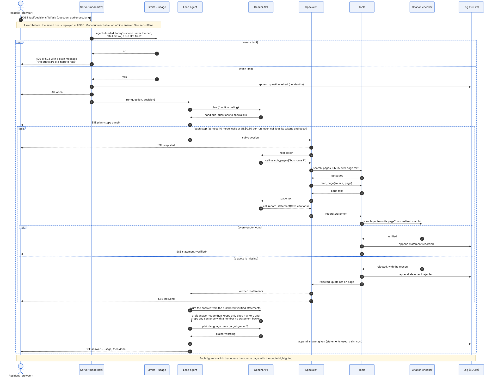
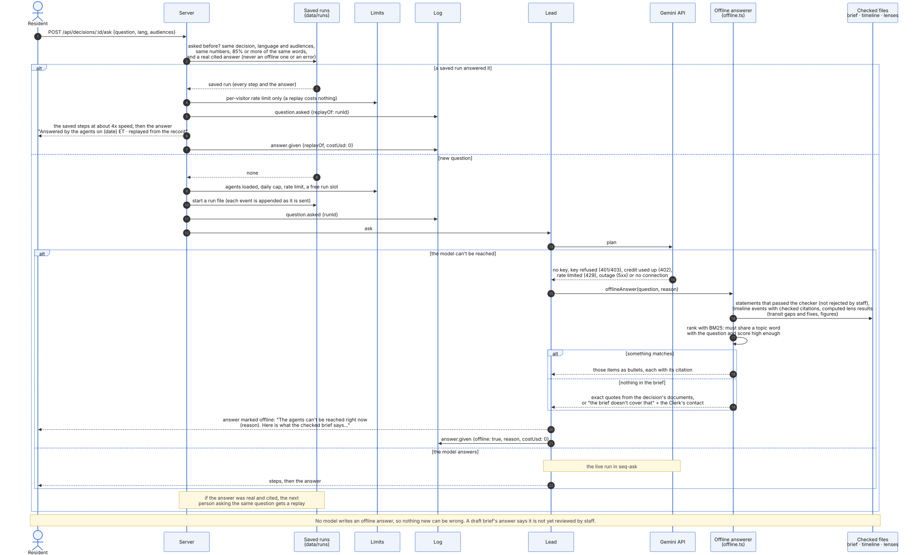
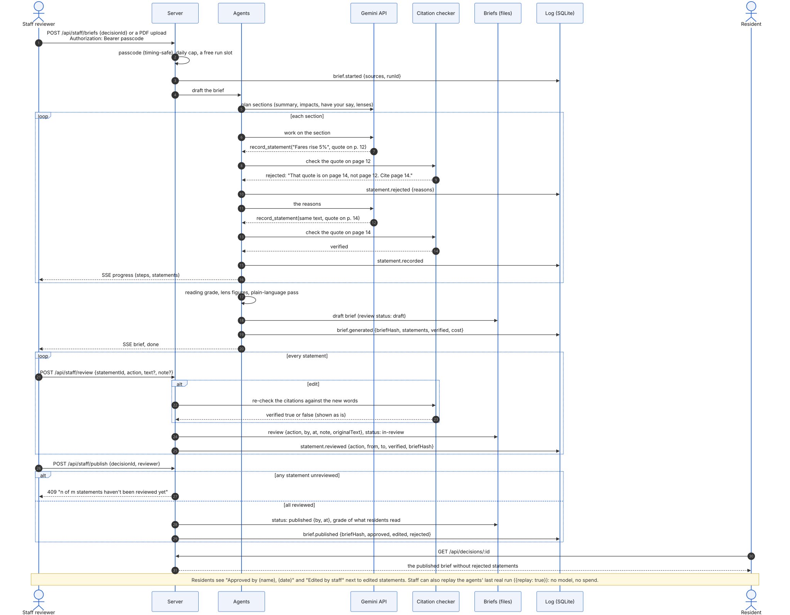

Municipal Agents is one small Node 24 service. A **lead agent** hands work to
**specialists**, each driven by a plain Markdown **skill** file. The specialists can
only search and read the decision's own documents and **record** findings through
tools. Every recording is **checked by code** before it counts: quotes must be on the
page they name, wording must follow the product's rules, numbers must come from the
quotes. Staff then review every statement before anything is published, and every
step lands in a **hash-chained public record**.

This page is for city IT teams, judges and curious residents. For the reasons behind
each choice, read the [architecture](../architecture.md). For all eleven UML diagrams,
read the [design](../design.md).



## The parts

| Part | Folder | What it does |
|---|---|---|
| Service | [`server/`](../../server/main.ts) | `node:http` API and web app, staff passcode, limits, spend, the record |
| Agents | [`agents/`](../../agents/index.ts) | The lead, the specialist loop, tools, page search, the Gemini client |
| Checks | [`shared/`](../../shared/verify.ts) | Citation check and reading grade, with no Node dependencies so the browser can run them too |
| Lenses | [`lenses/`](../../lenses/README.md) | Transit, cost, commitments, housing and construction results, computed ahead of time from open data |
| Data | `data/`, `cities/` | Source PDFs and their page text, hand-checked decisions, briefs, lens results |

The only outside service at run time is the model API. Lens results are computed
before deployment, and briefs are stored as files, so a resident opening a decision
page triggers no model call.

## Lead, specialists and skills

**The lead** ([`agents/lead.ts`](../../agents/lead.ts)) plans, runs specialists side
by side, and merges what they recorded. It never records facts itself.

**Each specialist** is one skill file, `agents/skills/<name>/SKILL.md`, plus the
shared rules in [`agents/skills/RULES.md`](../../agents/skills/RULES.md). A skill file
has a short header (name, description, the tools it may use) and plain instructions.
A communications officer can read exactly what each agent is told, and propose a
change in a pull request.

| Specialist | Job | Tools it may call |
|---|---|---|
| `explainer` | Summary, why now, impacts by audience, have your say, trade-offs, unknowns, glossary | `search_pages`, `read_page`, `record_statement`, `record_figure`, `record_tradeoff`, `record_unknown`, `record_term` |
| `transit-access` | Who can reach essential places by transit, gaps and fixes | `transit_gaps`, `search_pages`, `read_page`, `record_computed_figure`, `record_statement`, `record_figure`, `record_tradeoff`, `record_unknown` |
| `lifecycle-cost` | Upfront price against the whole-life cost, per household | `lifecycle_cost`, `search_pages`, `read_page`, `record_figure`, `build_lifecycle_cost`, `record_computed_figure`, `record_statement`, `record_tradeoff`, `record_unknown` |
| `commitments` | Public targets the decision touches and their status | `commitment_progress`, `search_pages`, `read_page`, `record_commitment`, `record_statement`, `record_unknown` |
| `housing-pipeline` | Homes from approval to completion, and what can't be tracked | `housing_stages`, `search_pages`, `read_page`, `record_computed_figure`, `record_statement`, `record_figure`, `record_unknown`, `record_tradeoff` |
| `construction-scout` | An illustrative construction scenario and what residents would notice | `construction_sites`, `search_pages`, `read_page`, `record_statement`, `record_computed_figure`, `record_tradeoff`, `record_unknown` |
| `translator` | Translates a brief, keeping hedges, numbers and names | none |

A specialist is offered only when the decision lists its lens and its skill file
exists. The rules every specialist follows are short: every fact cites a page, plain
words at grade 8, never decide or persuade, impacts are uncertain ("may"), say what is
unknown, name offices not people, copy quotes exactly, say which year a number is for.

## The tools

Reading tools find text. Recording tools are where the product rules are enforced
([`agents/tools.ts`](../../agents/tools.ts)).

| Tool | What it does |
|---|---|
| `search_pages` | BM25 keyword search over passages of about 10 lines (overlapping by half); returns up to 6 snippets with source and page |
| `read_page` | One full page of a source; " \| " marks a gap between columns |
| `record_statement` | One plain sentence with exact quotes; checked at once |
| `record_tradeoff` | One sentence with both sides; checked the same way |
| `record_figure` | A number from a document; the quote must contain it |
| `record_computed_figure` | A number from a lens result looked up in the same run, with its method |
| `record_unknown` | What the documents don't answer, and which public office could |
| `record_term` | A term explained in plain words |
| `record_commitment` | A public target with cited progress; code works out the status when given the numbers |
| `transit_gaps`, `lifecycle_cost`, `housing_stages`, `commitment_progress`, `construction_sites` | Read the precomputed lens result for this decision |
| `build_lifecycle_cost` | Build a cost lens from cited figures and stated assumptions |

The agents cannot browse the web, send messages or read other files. Their only
effect on the world is the draft they record into.

## The loop

The whole agent runtime is one function, `runStep` in
[`agents/loop.ts`](../../agents/loop.ts):

1. Send the specialist's instructions (rules, skill, the decision's details) and its
   task to the model, with its tools declared.
2. Run any tools the model asks for, and send back the results.
3. Repeat until the model stops calling tools, the step reaches its call limit, or the
   run's budget is used up.

Older page texts and search results are replaced with a short stub two turns later,
to keep each call cheap; the model can read the page again if it needs to. Every
model call passes through `budgetedCall`, which reserves the call from the budget,
calls the model, prices it and writes a `usage` entry to the record.

The model client ([`agents/gemini.ts`](../../agents/gemini.ts)) is plain `fetch` to
the Gemini API with no SDK: a 90-second timeout per call and up to 4 retries with
backoff for timeouts, rate limits and server errors. The models are set by
`LEAD_MODEL` and `SPECIALIST_MODEL` (both `gemini-3.6-flash` by default).

## A question's path



1. The browser posts the question to `POST /api/decisions/:id/ask` and reads the reply
   as server-sent events. See the [API](api.md).
2. The server checks the cheap things first, so a refused request costs nothing: the
   agents are loaded, today's spend is under the cap, this visitor is under the rate
   limit, a run slot is free.
3. The question is written to the record as `question.asked`, with no identity.
4. Greetings and "what can you do?" are answered at once, without a model.
5. The lead makes one model call to plan: up to 4 steps, each a specialist and a
   sub-question. The browser shows the plan.
6. The specialists work in parallel. Each recorded statement is checked on the spot
   (below), and the browser shows each step's tools and statements as they happen.
7. The lead writes the answer from **only** the verified statements, numbered, with
   `[n]` markers (and `[Cn]` for computed figures).
8. Code grounds the answer (below), then the plain-language pass shortens it if it
   reads above grade 9.
9. The answer is sent, `answer.given` is logged, and the stream ends with `done`.

If the model can't be reached (no credit, rate limit, outage, missing key), the
question is still answered without a model, from things already checked: the brief's
statements that passed the citation check (and staff didn't reject), the decision's
hand-checked timeline, and computed lens results. They are ranked against the question
with BM25; an item must share a meaningful word with the question and score well
enough. If nothing does, exact quotes from the decision's documents are the last
resort, and failing that the answer says so and names the clerk. The answer is marked
as offline ([`agents/offline.ts`](../../agents/offline.ts)). Nothing is written by a
model, so nothing new can be wrong.

A question that a real run already answered (same decision, language and audiences,
and the same question or very close: nearly all the same words and exactly the same
numbers) is replayed from that run's saved file instead, at no cost.



## A brief's path



1. Staff start a brief from `/staff` (or upload a PDF). See the [staff guide](staff.md).
2. The lead runs two explainer steps (overview; impacts, trade-offs and unknowns) and
   one step per lens, side by side.
3. The plain-language pass rewrites hard sentences and adds glossary entries.
4. The brief is assembled from verified findings only, its reading grade is computed,
   and it is saved as a **draft**. `brief.generated` is logged with the counts
   (statements, rejected attempts, figures, unknowns), the reading grade before and
   after the plain-language pass, each step's calls, the cost and the models.
5. Staff approve, edit or reject every statement. An edit is checked against its
   quotes again. Publishing needs a reviewer's name, and is refused until every
   statement has been reviewed. Rejected statements are left out of what residents
   see.





## Citation verification

A statement counts as verified only if it has at least one citation and every quote it
cites is found on the page it names. A program does this check, never a model
([`shared/verify.ts`](../../shared/verify.ts)).

**Before matching**, both the quote and the page are normalised:

- case, and all runs of spaces and line breaks;
- curly quotes to straight quotes, all dashes to a hyphen;
- ligatures split (`fi` to `fi`), odd spaces made plain, soft hyphens removed;
- words split by a hyphen at the end of a line joined again.

**Then the quote is looked for**, in order:

1. as a plain substring of the page;
2. with all spaces removed (PDF text sometimes splits words, as in "T otal");
3. word by word across columns. `pdftotext -layout` keeps columns side by side, so a
   sentence in one column is interleaved with the other column line by line. The
   matcher lets a sentence continue at the start of a column segment within the next
   3 lines.

**Nothing is fuzzy.** Every word must be present, in full and in order.

**Quotes are refused** if they cite a source that isn't this decision's, a page that
doesn't exist, contain an ellipsis, or are shorter than 8 characters.

**A failed check says how to fix it**, in words the model can act on
(`checkCitation` in `agents/tools.ts`):

- "That quote is on page 14 of row-2026-budget-book, not page 12. Cite page 14."
- "That quote is in <another source>, page 3, not <the cited source>."
- "Quote not found on <source> page 12. Closest text on that page: ..."

Every rejection is written to the record as `statement.rejected` with its reasons.

> [!NOTE]
> A quote on the page proves the words are there. It does not prove the sentence
> reads them fairly or keeps their context. That judgement is what staff review is for.

## Statement rules

Besides the citation check, each recorded statement must pass these rules in code
(`ruleProblems` and `recordStatement` in `agents/tools.ts`):

| Rule | Check |
|---|---|
| Short | 40 words at most |
| Neutral | Refused if it tells people what to think or how to vote ("you should vote", "we recommend", "vote for", "this is a bad plan") |
| Uncertain impacts | An impact must say "may", "might" or "could", and name an audience |
| Two-sided trade-offs | A trade-off needs a contrast ("but", "while", "however", "in exchange" and similar) |
| Readable | A sentence of 8 words or more is refused above grade 12 (summary and impacts) or grade 14 (elsewhere) |
| Numbers backed | Every number in the sentence must be in one of its quotes. A budget table "in $ thousands" counts: "$80.5 million" matches a quoted "80,483". Dates from the decision's hand-checked timeline are allowed. |
| On topic | The sentence must share at least one word or number with its quotes |
| Real | Placeholder text is refused; a repeated statement is merged |

## Answer grounding

The lead's written answer is checked once more by code (`groundAnswer` in
`agents/lead.ts`). Sentence by sentence, it:

- drops any sentence that gives voting advice;
- drops any sentence that states a number without a citation marker, unless that
  number appears in the verified statements the lead was given, the question, or the
  decision's hand-checked timeline;
- keeps only markers that point at real statements or figures, renumbers them in order
  of use, and keeps only the statements the text actually cites.

If nothing useful is left, the resident gets a plain "the documents don't say", with
who could answer.

> [!NOTE]
> The number check looks for each number as text, so a short number such as "5" can
> pass by coincidence. It is a safety net, not a proof.

## The plain-language pass

The product aims for grade 8 or lower. The reading grade is the Flesch-Kincaid grade
(0.39 × words per sentence + 11.8 × syllables per word − 15.59), computed by
[`shared/readability.ts`](../../shared/readability.ts) and shown on every brief. The
syllable counter is a heuristic.

After the specialists finish a brief, [`agents/plain.ts`](../../agents/plain.ts)
sends every verified sentence above grade 8 back to the model to be rewritten, in up
to two batched rounds. **Code decides whether a rewrite is kept.** It must:

- read easier than the original (a lower grade);
- keep every number exactly;
- still pass the statement rules (including "may" for impacts and both sides of a
  trade-off);
- still share words with its quotes (the citations don't change).

Otherwise the original stays, and the model is told why on the next round. Then a
glossary pass explains up to 10 municipal terms the brief uses ("levy", "capital
budget", "delegation", "minor variance" and others), each in one sentence with no
numbers.

Answers in the chat get the same treatment, aiming at grade 9 or lower (English only):
markers and numbers must survive, and the rewrite must read easier and give no advice.

## Spend caps and limits

| Limit | Value | Where |
|---|---|---|
| One run (question, brief or translation) | 40 model calls or US$0.50, whichever comes first | `RUN_MAX_CALLS`, `RUN_MAX_USD` in `agents/lead.ts` |
| Reserve for the answer | 2 calls and US$0.05 held back so the lead can still write and simplify the answer | `askWith` |
| Reserve for a brief's plain-language pass | 3 calls and US$0.04 | `generateBriefWith` |
| Per step in a question | 5 calls (6 when the plan has 1 or 2 steps) | `askWith` |
| Per step in a brief | overview 11, impacts 9 (19 kept for the explainer), lenses share the rest, 3 to 7 calls each | `generateBriefWith` |
| Daily cap on model spend | US$5 by default, reset at midnight Toronto time | `DAILY_LIMIT_USD` |
| Per visitor | 30 model-backed questions or translations per 10 minutes (replays and offline answers don't count), by IP held in memory only | `ASK_PER_WINDOW`, `ASK_WINDOW_MIN` |
| Runs at once | 4 | `MAX_CONCURRENT_RUNS` |
| Question time limit | 240 seconds | `RUN_TIMEOUT_SEC` |
| Brief or translation time limit | 900 seconds | `BRIEF_TIMEOUT_SEC` |

Spend is counted from the `usage` entries in the record, so the daily cap and the
public spend page (`/spend`, `GET /api/usage`) read the same numbers. When the cap is
reached, new questions get a plain message and the briefs stay readable. Energy and
CO2e on the spend page are estimates from token counts, with the method shown.

## The hash-chained record

Every brief, check, question, answer, review, publication and model call is appended
to the record in SQLite ([`server/log.ts`](../../server/log.ts)). Anyone can read it at
`/log` or `GET /api/log`.

**Entry kinds:** `source.added`, `brief.started`, `brief.generated`,
`statement.recorded`, `statement.rejected`, `statement.reviewed`, `brief.published`,
`question.asked`, `answer.given`, `translation.made`, `usage`, plus the record's own
bookkeeping: `record.purged` and `record.migrated`.

**The hash.** Each entry has a header (sequence number, time, actor, kind, decision)
and its content (the payload). The content is stored apart from the chain, and the
chain covers the content's own hash:

```text
payloadHash = SHA-256( canonicalJSON(payload) )
hash        = SHA-256( prevHash + canonicalJSON({seq, at, actor, kind, decisionId, payloadHash}) )
```

Canonical JSON ([`server/canonical.ts`](../../server/canonical.ts)) sorts keys, has no
whitespace and drops undefined values. The first entry's `prevHash` is 64 zeros.
Changing any past entry, or its content, changes a hash and breaks every link after it.

**Why the content has its own hash: records retention.** A municipality may have to
destroy a record once its retention period under its records retention by-law ends
(Municipal Act, 2001, s. 255), and an append-only record can't delete anything. So
staff can **purge** one entry's content (`POST /api/staff/purge`, see the
[staff guide](staff.md#purge-content-when-its-retention-period-ends)):

- the entry's payload becomes `null`, and the entry gets a `purged` field (when, why,
  and which entry did it);
- its header, `payloadHash` and `hash` stay exactly as they were, so the chain still
  verifies;
- a new `record.purged` entry is appended, naming the entry, its kind, its payload hash,
  the reason and who did it. That entry can't itself be purged.

**Guards.**

- Each append, and each purge, is one `BEGIN IMMEDIATE` transaction, so entries are
  serialised and the chain stays in a line.
- SQLite triggers refuse any `UPDATE` or `DELETE` on the chain. On the content table
  they refuse deletes, and allow only one kind of update: a purge that blanks the
  content and records when and by which entry.
- `verifyChain()` recomputes every hash from the start. It also checks that each
  entry's content matches its `payloadHash`, and that content which is gone has a
  `record.purged` entry naming that entry and that payload hash. Content removed any
  other way breaks the chain. The server runs it at start-up, and `GET /api/log/verify`
  runs it on request; the answer counts purged entries.
- The browser checks the chain itself with the Web Crypto API
  ([`web/src/lib/hash.ts`](../../web/src/lib/hash.ts)), with the same rules for content
  and purges, so a visitor doesn't have to take the server's word. The Record page shows "Chain intact: N entries" with "SHA-256 ·
  checked in your browser". A test (`server/canonical.test.ts`) keeps the browser's and the
  server's canonical JSON in agreement.

**Older records.** A record written before content was hashed separately (format 1,
which hashed the payload itself) is migrated once when the server starts: its old chain
is checked end to end first (a broken one is not migrated, so tampering can't be
laundered), every entry is re-hashed in the new format with its old hash kept as
`legacyHash`, and a `record.migrated` entry records the old and new head hashes.

**What it doesn't stop.** Whoever controls the server could rewrite the whole chain
from the first entry. The fix is to publish the latest hash somewhere the city does not
control alone (council minutes, a public Git repository, a timestamping service) on a
schedule. Publishing the head hash is **Planned**.

The record holds no personal data by design: questions are logged with the actor
`visitor` and no identifier. If someone types personal details into a question anyway,
staff can purge that entry's content. See [Security and privacy](security-privacy.md).

## Where it runs



One Docker image on one Fly.io machine in Toronto (`yyz`), with a 1 GB volume for the
record, staff-edited briefs and uploads. The model API is the only call that leaves
Canada; a city can swap in a Canadian-hosted or on-premises model by changing one
client file. See [Self-host](self-host.md).

## The data shapes



Every part agrees on [`shared/types.ts`](../../shared/types.ts). The key chain is
`Statement → Citation → SourceDoc`: every sentence a resident reads points to a quote on
a numbered page of a named document.
