Municipal Agents helps residents understand a proposed municipal decision: **what is
proposed, how it may affect them, and when they can have a say**. AI agents draft a
short brief from the city's own public documents. Code checks that every quote is
really on the page it cites. A named staff member reviews every statement before the
brief is published. Everything the agents and staff do is written to a public record
that cannot be changed quietly.

The pilot runs on public data from Waterloo Region, Ontario, at
[municipal-agents.fly.dev](https://municipal-agents.fly.dev). It is a working
prototype built at CIVIC Hack 2026, not an official city service.

<div class="cards">
<a class="card" href="residents.md"><span class="card-k">Residents</span><span class="card-t">Read a brief and have your say</span><span class="card-d">Check any figure on its source page, ask a question, read it in your language, add the dates to your calendar.</span></a>
<a class="card" href="staff.md"><span class="card-k">City staff</span><span class="card-t">Draft, review and publish</span><span class="card-d">Start a brief from a decision or a PDF, approve, edit or reject each statement, publish under your name.</span></a>
<a class="card" href="planners.md"><span class="card-k">Planners</span><span class="card-t">The five lenses</span><span class="card-d">Transit access by Connection Scan, lifecycle cost, commitments, the housing pipeline and the construction scout.</span></a>
<a class="card" href="api.md"><span class="card-k">Developers</span><span class="card-t">API, embed and self-hosting</span><span class="card-d">A plain JSON and streaming API, a one-line widget for city pages, and one Docker image to run anywhere.</span></a>
</div>

## Try it in one minute

Open a decision on the live site, for example the
[Region of Waterloo 2027 budget](https://municipal-agents.fly.dev/d/row-2027-budget).
Click any number to see the PDF page it came from, with the quote highlighted.

Or read the same data from the API. No key is needed for public routes:

```bash
# Decisions, soonest chance to take part first
curl -s https://municipal-agents.fly.dev/api/decisions

# One decision with its brief, lenses and sources
curl -s https://municipal-agents.fly.dev/api/decisions/row-2027-budget

# Check the public record's hash chain
curl -s https://municipal-agents.fly.dev/api/log/verify
```

The [API reference](api.md) lists every route, and the
[embed guide](embed.md) shows how to put a decision's card on a city web page.

## What makes it different

Five product rules are enforced in code, not left to the model:

1. **Every figure cites a page.** A statement is kept only if each quote it cites is
   found, word for word, on the page it names. A program does that check, not the AI.
   See [citation checks](how-it-works.md#citation-verification).
2. **Plain words.** Briefs aim for grade 8 or lower. The reading grade is measured and
   shown, and a plain-language pass rewrites hard sentences without changing a number.
3. **Agents never decide, and never say what to think.** They explain, lay out
   trade-offs both ways and say what the documents don't answer.
4. **Staff publish.** Agent output is a draft until a named staff member has reviewed
   every statement and published it. See the [staff guide](staff.md).
5. **The record can't be edited quietly.** Every brief, check, question, answer,
   approval and dollar spent is appended to a hash-chained log that anyone can verify,
   in the browser. See [the public record](how-it-works.md#the-hash-chained-record).

Municipal Agents is never the official notice. Every decision page links to the city's
own notice, and residents take part through the city's official channels.

## How it fits together



One Node 24 process serves the web app, the API and the agents. A lead agent plans and
hands questions to specialists, each described in a plain Markdown skill file a
non-programmer can read. Lenses (transit, cost, commitments, housing, construction)
are computed ahead of time from open data. The only outside service at run time is the
language model. Read [how it works](how-it-works.md) for the details, and
[self-hosting](self-host.md) to run your own copy.

## Where to go next

| If you are | Start with |
|---|---|
| A resident | [Guide for residents](residents.md) |
| A clerk, communications or engagement officer | [Guide for city staff](staff.md) |
| A planner or analyst | [Guide for planners](planners.md), then [planner workflows](../planner-workflows.md) |
| In city IT, privacy or records | [Security and privacy](security-privacy.md), [self-hosting](self-host.md) |
| A developer | [API reference](api.md), [embed](embed.md) |
| Bringing it to another municipality | [Adapt it to your city](adapt-your-city.md) |
| Judging or evaluating it | [How it works](how-it-works.md), [evals](evals.md), [architecture](../architecture.md) |

Questions not answered here are probably in the [FAQ](faq.md). Changes are listed in
the [changelog](changelog.md).
