Municipal Agents is one Node 24 process and a folder of files. It has no runtime npm
dependencies, no separate database server and no queue. The public site runs on one
small Fly.io machine in Toronto, but the same Docker image runs on any container host,
on a city server, or on a laptop. This page covers all three, every setting, and how
to change the AI model, including to one hosted in Canada or on the city's own hardware.



## What you need

| | Why |
|---|---|
| Node 24 or later | Runs the TypeScript files directly (type stripping), with the built-in `node:sqlite` and test runner. |
| `pdftotext` and `pdfinfo` (poppler-utils) | Turns PDFs into page text: for `npm run sources` and for staff PDF uploads. The Docker image includes them. |
| A Gemini API key | For the agents. Without one, the site still serves every brief, source and record; see [Without a key](#without-a-model-key). |
| A staff passcode | Any long random string. Staff routes answer `503` until it is set. |
| About 1 GB of disk for data | The record, briefs, uploads and saved runs, plus a copy of the committed data (about 40 MB for Waterloo Region). |

## Run it on your computer

```bash
git clone https://github.com/RichardLi-1/municipal-agents.git
cd municipal-agents
npm install                       # development tools only: TypeScript and type definitions
printf 'GEMINI_API_KEY=your-key\nSTAFF_TOKEN=a-long-random-passcode\n' > .env
npm run build                     # builds the web app into web/dist
npm start                         # http://localhost:4100
```

`npm start` and `npm run dev` load `.env` if it exists. `.env` is in `.gitignore`; never
commit it.

To work on the web app with hot reload, run the service and Vite side by side. Vite
serves the app on port 5173 and passes `/api` to the service on port 4100:

```bash
npm run dev                       # the service, restarting when a file changes
npm --prefix web install
npm --prefix web run dev          # http://localhost:5173
```

Useful checks:

```bash
npm test                          # server, shared checks, agents and lenses (no model calls)
npm run typecheck
node scripts/smoke.ts http://localhost:4100           # health, decisions, a PDF, the calendar
node scripts/smoke.ts http://localhost:4100 --ask     # also asks one real question (spends money)
```

## Deploy to Fly.io

The repository carries a working `fly.toml` and `Dockerfile`. These steps create your own
copy of the app.

1. Install `flyctl` and sign in with `fly auth login`.
2. Pick an app name and region. Edit the top of `fly.toml`:

   ```toml
   app = "your-city-agents"
   primary_region = "yyz"            # Toronto; `fly platform regions` lists the others
   ```

   Then create the app:

   ```bash
   fly apps create your-city-agents
   ```

3. Create the volume. Its name must match `source` under `[[mounts]]` in `fly.toml`:

   ```bash
   fly volumes create municipal_data --region yyz --size 1
   ```

4. Set the secrets. They are encrypted by Fly and reach the app as environment variables:

   ```bash
   fly secrets set GEMINI_API_KEY=your-key STAFF_TOKEN=a-long-random-passcode
   ```

5. Deploy, then run the smoke test against your app:

   ```bash
   fly deploy --remote-only
   node scripts/smoke.ts https://your-city-agents.fly.dev
   ```

   `npm run deploy` does both, but its smoke test checks `https://municipal-agents.fly.dev`
   unless you set `SMOKE_URL`:

   ```bash
   SMOKE_URL=https://your-city-agents.fly.dev npm run deploy
   ```

What `fly.toml` sets up:

| Setting | Value | Why |
|---|---|---|
| Machine | `shared-cpu-1x`, 1 GB memory | Enough for one process serving JSON and PDFs and a few agent runs at once. |
| Always on | `auto_stop_machines = "off"`, `min_machines_running = 1` | Agent runs stream for minutes; the record is a local file. |
| Health check | `GET /api/health` every 30 s, 15 s grace | Fly restarts the machine if it fails. |
| HTTPS | `force_https = true` | Fly terminates TLS. |
| Concurrency | soft limit 200, hard limit 250 requests | |
| Volume | `municipal_data` at `/data`, 1 GB | The record and everything staff change. |
| Env | `PORT=8080`, `DATA_DIR=/data`, `LEAD_MODEL` and `SPECIALIST_MODEL` = `gemini-3.6-flash`, `DAILY_LIMIT_USD=5` | |

Run one machine only. The record is a SQLite file on that machine's volume, and two
machines would each keep their own record. Scaling past one machine means moving the
record to Postgres first (see [architecture](../architecture.md), section 4). **Planned**

> [!NOTE]
> `primary_region = "yyz"` keeps the record, briefs and uploads in Toronto. The model
> calls are a separate question: see [Choose the model](#choose-the-model).

## Run it with Docker

The same image runs anywhere Docker does. Mount a volume at `/data` so the record
survives restarts.

```bash
docker build -t municipal-agents .
docker volume create municipal-data
docker run -d --name municipal-agents -p 8080:8080 \
  -v municipal-data:/data \
  -e GEMINI_API_KEY=your-key \
  -e STAFF_TOKEN=a-long-random-passcode \
  -e PUBLIC_URL=https://agents.your-city.ca \
  municipal-agents
curl http://localhost:8080/api/health
```

The image is built in two stages ([`Dockerfile`](../../Dockerfile)):

1. **Build**: copies the repository and builds the resident web app with Vite, then the
   product pages (`landing/`) and these docs (`docs-site/`) with their own `npm run build`.
   A failed build doesn't block the API: `/` and `/docs` fall back to the resident app,
   or a "not built yet" page; the smoke test reports it.
2. **Runtime**: `node:24-slim` with `poppler-utils`, the code (`server/`, `agents/`,
   `shared/`, `lenses/`), `cities/`, the committed `data/`, the three built sites and the
   widget (`embed/`). It sets `PORT=8080` and `DATA_DIR=/data` and runs
   `node server/main.ts`.

`.dockerignore` keeps `.env`, `.git`, `node_modules`, the local record (`data/log.db*`),
`data/cache` and `data/uploads` out of the image.

Put a reverse proxy with TLS in front of it (nginx, Caddy, the city's load balancer).
Turn off response buffering for `/api/decisions/*/ask` and `/api/staff/briefs`, which
stream events for up to 15 minutes. The service already sends `X-Accel-Buffering: no`
and a comment every 15 s to keep the connection open.

## Environment variables

Every setting has a default, so `npm start` works with none. The service reads them once
at start ([`server/config.ts`](../../server/config.ts)).

| Variable | Default | What it does |
|---|---|---|
| `GEMINI_API_KEY` | none | The model API key. Only ever sent in a request header. Keep it a secret. |
| `STAFF_TOKEN` | none | The staff passcode. Without it, staff routes answer `503`. Keep it a secret. |
| `LEAD_MODEL` | `gemini-3.6-flash` | Model for the lead agent: planning, writing answers, the plain-language pass, and translations. |
| `SPECIALIST_MODEL` | `gemini-3.6-flash` | Model for the specialists. |
| `DAILY_LIMIT_USD` | `5` | Daily cap on model spend, in US dollars. Resets at midnight Toronto time. |
| `ASK_PER_WINDOW` | `10` | Questions (and translations) one IP address may start per window. |
| `ASK_WINDOW_MIN` | `10` | The window, in minutes. |
| `MAX_CONCURRENT_RUNS` | `4` | Agent runs at once, across everyone. |
| `RUN_TIMEOUT_SEC` | `240` | A visitor's question stops after this long. |
| `BRIEF_TIMEOUT_SEC` | `900` | A full brief or a translation stops after this long. |
| `PORT` | `4100` (`8080` in the image) | Port to listen on. 4100 matches the Vite dev proxy. |
| `HOST` | `0.0.0.0` | Address to listen on. |
| `DATA_DIR` | `<APP_ROOT>/data` (`/data` in the image) | Where the record, briefs, uploads and saved runs are written. |
| `APP_ROOT` | the repository root | Where `cities/`, the committed `data/` and the code are. |
| `WEB_DIST` | `<APP_ROOT>/web/dist` | The built web app. |
| `PUBLIC_URL` | the request's host | The public address, used in links handed to other sites: calendar files and feeds, the embed card, OpenAPI. |
| `CITY` | the first file in `cities/` | The default city, when `cities/` has more than one. The API serves every city; `?city=<id>` picks one. |
| `GIT_SHA` | Fly's image reference, else `dev` | Shown as `version` in `/api/health`. |
| `SMOKE_URL` | `https://municipal-agents.fly.dev` | Default target of `scripts/smoke.ts`. |

Where the other built sites are ([`server/site.ts`](../../server/site.ts) decides which
one answers a path):

| Variable | Default | Serves |
|---|---|---|
| `DOCS_DIST` | `<APP_ROOT>/docs-site/dist` | These docs, at `/docs` and `/docs-assets/`. |
| `LANDING_DIST` | `<APP_ROOT>/landing/dist` | The product pages: `/`, `/pricing`, `/security`, `/company`, `/contact`, `/changelog`. |
| `EMBED_DIR` | `<APP_ROOT>/embed` | The [widget](embed.md), `/embed.js`, and its demo at `/embed/demo`. |

A site that hasn't been built falls back to the resident app, so a deployment without
the docs or product pages still serves something useful.

## What lives where

The image carries the committed data in `/app/data`. The volume at `/data` holds what
changes while the site runs. At every start, `server/main.ts` mirrors the committed files
into the volume, so the server and the agents read one folder.

| In `DATA_DIR` | What | Survives a redeploy? |
|---|---|---|
| `log.db` (and `-wal`, `-shm`) | The public record: SQLite, append-only, hash-chained | Yes. Never in the image. |
| `briefs/<id>.json` | Briefs, with every staff review | Yes. At start, whichever copy is newer wins: a fresher committed brief replaces an older one on the volume. |
| `briefs/<id>.<lang>.json` | Cached translations | Yes |
| `uploads/` | PDFs staff uploaded, their page text and their decisions | Yes |
| `runs/<runId>.jsonl` | Every agent run's events: the answer cache and the evidence of what the agents said | Yes |
| `cache/brief-history/` | The previous version of a brief each time it is rewritten | Yes |
| `sources/`, `decisions/`, `lenses/`, `open/` | Copies of the committed data | Replaced from the image at each start (uploads are kept) |
| `renders/` | Construction-lens images made at run time, if any | Yes. Committed renders are served from the image. |

At start the service also checks the whole record's hash chain and logs `chain intact`
or `chain BROKEN`.

> [!IMPORTANT]
> **Upgrading a record made before payload hashing.** Older versions hashed each
> entry's content directly. The first time a newer version opens such a `log.db`, it
> checks the old chain end to end, re-hashes every entry in the new format (keeping the
> old hash as `legacyHash`) and appends a `record.migrated` entry with the old and new
> head hashes. It logs `log: migrated <n> entries to payload hashing`. If the old chain
> is broken it does not migrate and the service stops with "the format-1 chain is
> broken", so tampering is never laundered into a fresh chain. Take a volume snapshot
> before the first deploy of the new version, and note the old `headHash` from
> `GET /api/log/verify`.

### Backups

- **Volume snapshots.** Fly.io snapshots volumes daily by default. List them with
  `fly volumes list` and `fly volumes snapshots list <volume-id>`. Check the retention
  your organisation needs.
- **The head hash.** Copy `headHash` from `GET /api/log/verify` somewhere the city doesn't
  control alone (council minutes, a public Git repository) on a schedule. A restored or
  rewritten record that doesn't lead to that hash is caught. This is a manual step today;
  publishing it automatically is **Planned**.
- **Briefs** are plain JSON. The committed ones are in Git; staff edits are on the volume.

## Choose the model

The agents call Google's Gemini API through one small file,
[`agents/gemini.ts`](../../agents/gemini.ts): plain `fetch` to `generateContent`, with a
90-second timeout per call and up to four retries with backoff for timeouts, `429` and
`5xx`. No SDK.

### The default

`gemini-3.6-flash` for both the lead and the specialists. Prices the code uses to count
spend, in US dollars per million tokens (thinking tokens count as output):

| Model | Input | Output |
|---|---|---|
| `gemini-3.6-flash` | 0.75 | 3.75 |
| `gemini-3.8-flash` | 0.75 | 3.75 |
| `gemini-3.5-flash-lite` | 0.30 | 2.50 |
| any other name | 0.75 | 3.75 (priced high so spend is never understated) |

Switch between these with `LEAD_MODEL` and `SPECIALIST_MODEL`. Google's published prices
change over time (the architecture notes a rise on 1 January 2027), so check them and
update `PRICES` in `agents/gemini.ts` to keep the spend page and the caps honest.

A typical question costs a few US cents. Our eval run averaged US$0.07 a question; the
first full brief for the 2027 budget cost US$0.24 and the current one US$0.37 (see
[evals](evals.md) and `GET /api/usage`).

### A Canadian-hosted or on-premises model

The public prototype sends prompts (public document text and residents' questions) to
the Gemini API, which is a US service. The record, briefs and uploads stay in Toronto.
For production, a city should keep model calls in Canada or on its own hardware, and
review the arrangement under MFIPPA and its privacy impact assessment process (see
[security and privacy](security-privacy.md)).

The design makes this a change to one file. Everything that decides what residents see
(the citation check, the wording rules, the reading grade, the answer's number check, the
lens maths) is ordinary code and doesn't depend on the model.

| Option | What changes |
|---|---|
| **Vertex AI, Montréal** (`northamerica-northeast1`) | Same request and response format as today. Change `ENDPOINT` in `agents/gemini.ts` to the regional Vertex AI URL for your project and send a Google Cloud access token instead of the `x-goog-api-key` header. At the time of writing that region lists Gemini 3.5 and 3.8 Flash but not 3.6 Flash, so set `LEAD_MODEL` and `SPECIALIST_MODEL` to one it offers. |
| **A Canadian-hosted provider** | Write a function with the same shape as `callGemini` that translates the request to the provider's API and the reply back. |
| **An open-weight model on the city's hardware** | The same, pointing at the city's own model server. Set its price to what the city wants to count (for example zero, or a share of the hardware). |

Today there is no setting that picks a provider; it is a code change. A provider switch by
environment variable is **Planned**.

What a replacement must do, so the rest of the code is unchanged:

- Accept a `GeminiRequest`: a `system` prompt, `contents` (user and model turns, including
  `functionCall` and `functionResponse` parts), `tools` (function declarations with JSON
  schemas), `toolMode` (`AUTO`, `ANY` or `NONE`), an optional `jsonSchema` for structured
  output, `temperature`, `maxOutputTokens`, a timeout and an abort signal.
- Return a `GeminiResult`: the model's turn as `content`, its `text`, the tool `calls` it
  asked for, a `finishReason`, token `usage` and `costUsd`.
- Be wired in as `callModel` in `defaultDeps()` in [`agents/lead.ts`](../../agents/lead.ts),
  with a `PRICES` entry so spend is counted.
- Handle function calling and JSON-schema output reliably, in English and the languages in
  `cities/<id>.json`, with room for prompts of tens of thousands of tokens.

Then run the agent tests (`npm test`, which use a fake model) and the evals against the
real model before switching the public site:

```bash
node --env-file=.env agents/evals/run.ts --cap 1.00
```

### Without a model key

If the model can't be reached (no key, no credit, an outage), the site keeps working:
briefs, sources, lenses, the calendar and the record don't call a model. A question is
answered from the brief's checked statements, ranked against the question, with their
citations and a note that the agents can't be reached; the answer is marked `offline`.
New briefs and translations can't be made until the model is back.

## Checklist before going live

- [ ] `STAFF_TOKEN` is long and random, and shared only with the staff who review.
- [ ] `GEMINI_API_KEY` (or your model's credentials) is a secret, never in Git.
- [ ] `DAILY_LIMIT_USD` matches the budget you are willing to spend each day.
- [ ] `PUBLIC_URL` is your public address.
- [ ] One machine, with a volume at `/data`, and snapshots on.
- [ ] `node scripts/smoke.ts https://your-address` passes.
- [ ] `GET /api/log/verify` says `"intact": true`; you have a place to publish `headHash`.
- [ ] The model's region and terms have been reviewed by the city's privacy office.
